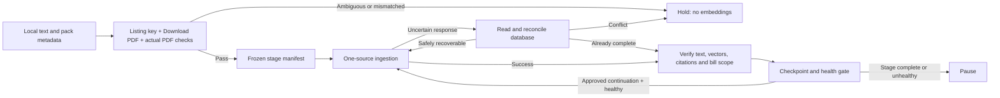

# Plan: controlled jobs for trackable existing text

> **Status: Living.** R7 follow-up; [spec](../specs/2026-10-09-trackable-corpus-jobs.md), [fresh evidence](../research/2026-10-09-trackable-corpus-inventory.md). First 25-document stage completed and owner confirmed RAG works; all 91 passing small sources completed and verified, including final 41 as 30 + 11. Broader R7 holds and medium tier remain open. No persistent service authorized. Existing branch: `task/corpus-single-pilot-20261009`; main unchanged. Sequential, no delegation.

## Exact first-stage release authorization — 2026-10-09

Owner approved the concrete 25-document / 681-chunk stage, USD 0.08 budget and post-stage statistics refresh: “Yes, continue with the ingestion. Then you can give me one or two documents on which I can test the rag, like a sample set, and then we can continue with the next batch of ingestion.” Execute only J7's first stage, verify and supply two source-grounded sample prompts; pause before any next batch. Preserve the proposal/dry-run artifacts; a separate `stage-01-release.json` records authorization against proposal hash `0d2f7c2efdc5848ef8c72807a44caf021f7bb03a9477903db0f1e8de4029ffc5`. Runtime release/health/checkpoint files and `docs/research/2026-10-09-trackable-corpus-stage-01-run.md` are the additional evidence write scope. No destructive repair, service installation, later stage or deployment is authorized by this release.

## Implementation authorization — 2026-10-09

Owner said “go” after reviewing this plan. Proceed with J1–J6: read-only PDF/source preflight, worker/recovery/supervisor implementation and tests, capacity investigation and a concrete first-stage release proposal. The plan's J6 gate remains: no further live ingestion until the exact released manifest and continuation/maintenance scope are authorized. Persistent OS-service installation and destructive compensation remain separate actions. Partial writes may be held with a precise repair inventory; this avoids expanding into endpoint/schema changes during this scripts-only implementation.

## Proposed operation

Use a resumable job with one worker and one document at a time. Start with the 347 small candidates; release only those that pass actual-PDF preflight. Process in stages of at most 25 documents / 1,000 expected new chunks, with a two-second gap between writes. The other 117 candidates follow only after medium-document limits have been measured. The 35 ambiguous-key candidates, two failed PDFs and previous three text-only holds do not enter the queue.

Local execution is the default because the source text is on the laptop. Sleep/offline time pauses progress; it must not damage it. A process supervisor can restart the worker after a crash or reboot, but must respect persisted holds, health pauses and approved stage boundaries. Durable checkpoints alone do not supply that supervision. An always-on host is an optional later move requiring an approved source transfer and secret setup, not a prerequisite for preparing this job.

## Ordered tasks and exact write scopes

Runtime artifact root for the next job: the current thread artifact directory's `corpus-job-plan/`. Existing historical artifacts stay immutable. Listed files below are proposed scopes, not permission to execute production writes.

| Task | Depends on | Write scope | Acceptance evidence |
|---|---|---|---|
| J0. Refresh and classify candidates | — | This spec/plan, research snapshot, R7 tracker, runtime snapshot files | Done for planning: 464 candidates, 347 small / 117 medium; 35 mapping and two PDF holds; live counts refreshed |
| J1. Build source/PDF preflight manifest | J0 | `scripts/corpus-job-preflight.mjs`, `scripts/corpus-job-preflight.test.mjs`, runtime candidate/pass/hold files | Reread source text/hash; run current chunker; check both bill features, actual UI PDF and PDF identity/version; all sources have evidence or hold; no embeddings/writes |
| J2. Generalize bounded worker | J1 manifest contract | `scripts/corpus-stage-job.mjs`, `scripts/corpus-stage-job.test.mjs` | Replace hard-coded prior stage with explicit approved manifest limits; current-source/key/PDF checks; budget/gap controls; verified successes skip on resume; first failing guard tests proven red |
| J3. Reconcile uncertain/partial outcomes | J2 | Same worker/test files | Timeout-after-success causes no duplicate paid call; missing/invalid chunks or text conflict stop unless a tested safe resume path exists; unchanged-text endpoint short circuit cannot falsely mark missing embeddings complete |
| J4. Add restart supervisor | J3 | `scripts/corpus-job-supervisor.mjs`, `scripts/corpus-job-supervisor.test.mjs`, `docs/operations/corpus-jobs.md` | One worker only; inspect lock owner before stale-lock recovery; bounded transient retries; persist pause/hold/completion; restart never clears manual hold; document optional OS service without installing it |
| J5. Verify runner and capacity gates | J4 | Those tests, this plan/spec, runtime validation and health records | Crash/restart/partial-write simulations in disposable fixtures, full checks below, representative broad/scoped baseline and available compute metrics; no production failure injection |
| J6. Freeze first released stage | J5 | Runtime approved-scope manifest/checksums, this plan and R7 tracker | Exact source IDs, stage counts, total/chunk/token bounds, PDF evidence, budget, maintenance and compensation scope are reviewable; owner authorizes this concrete release before live writes |
| J7. Execute and verify released stage | Exact J6 authorization | Only named manifest's production documents/chunks; runtime receipts; execution research; this plan/R7 | Exact per-source hash/key/URL/span/vector checks; retrieval and owner UI sample; billed usage recorded; stats/health gates pass; next-stage continuation follows only the authorized policy |
| J8. Consider remaining tier | J7 measured evidence | This plan/spec and next manifest artifacts | Medium tier remains held until observed per-document limits and capacity justify it; no automatic addition of uncertain or nonbill records |

## Resume and retry policy

Checkpoint before each live request; atomically save receipts and verification after it. On restart, verify manifest hash, target, lock ownership, live source/hash/identity and every completed receipt before continuing. A missing local receipt does not mean a database write failed.

For connection failures, 429 and transient 502/503/504 responses: reconcile the source first, then retry only when state permits. Proposed maximum five attempts per source, exponential delays starting at five seconds, capped at two minutes with jitter and Retry-After respected. A long Retry-After persists a wake-up time rather than spinning. Authentication/validation errors, identity mismatch, changed text, provider resource-limit failures or exhausted attempts stop and report. Unclassified errors do not retry indefinitely. No wall-clock completion promise until measured throughput exists.

The existing endpoint may leave a partial text/chunk state after interruption. J3 must prove an exact-source missing-work recovery path, including chunker version and valid embedding checks. If it cannot do so without changing the endpoint, pause and revise the write scope; do not silently treat a generic POST as safe recovery. Never delete/recreate successful sources merely to restart a batch.

## Load and continuation gates

- One worker limits concurrent ingestion; embeddings are generated by the provider. Chunking, database writes and index growth still consume resources. Worker count alone does not prove CPU safety.
- Before release, record actual Supabase compute tier/RAM and available CPU/memory metrics. Measure representative broad/scoped retrieval p95 over repeated probes with ingestion idle. Earlier single warm SQL timings are not a p95 baseline.
- Proposed health pause: retrieval p95 over twice the idle baseline in two consecutive windows, sustained CPU above 80% for two minutes when trustworthy metrics are available, repeated database errors/timeouts or any resource-limit response. These starting thresholds require review against the real metric source. Without CPU telemetry, use small supervised stages; do not claim an unattended CPU guard exists.
- Check health before and after each stage and periodically during a stage. A health pause resumes only after sustained recovery; repeated pauses require review instead of raising concurrency. Pause at the first new stage for owner RAG/citation testing before further expansion. Subsequent stages may run automatically only inside an explicitly authorized manifest/continuation policy and total budget.
- Re-read index/database sizes after stages. The earlier ~206 MiB HNSW index and 512 MB shared_buffers provide context only. A ~358 MiB index-size review threshold is conservative, not a proof that an index must fit buffers or that larger indexes fail. No automatic compute/index changes.
- After a released bulk stage, perform the authorized `ANALYZE public.document_chunks; ANALYZE public.documents;` and compare planner live-row estimates with real counts. After a database restart, include `ANALYZE public.desk_rows;` and re-establish health before continuing.
- Preserve original OCR/text and exact failed-source inventory. No orphan vectors from preflight holds. If identity invalidates after a live write, stop and expose an exact bounded compensation inventory; no unapproved cleanup beyond the already completed 61-row deletion.

## Verification commands and completion

For implementation: `node --experimental-strip-types --test scripts/corpus-job-preflight.test.mjs scripts/corpus-stage-job.test.mjs scripts/corpus-job-supervisor.test.mjs`, `npm test`, `npm run lint`, `npm run build`, `git diff --check`. These script/test paths are now implemented. Any endpoint/schema scope expansion needs a revised plan and repository-required Deno/SQL verification. Record exact failures, outcomes and build warnings. Prove recovery tests fail against the missing/defective behavior before relying on green results.

For this planning-only change: reconcile classification counts/estimates, inspect document links and run `git diff --check`. No application code changed, so application suites need not be rerun for the plan. Leave previous uncommitted work intact. Implementation, scheduler installation, further production data changes, deployment and main integration remain pending.

## Implementation/preflight outcome — 2026-10-09

Additional durable write scope: `docs/operations/corpus-jobs.md` and `docs/research/2026-10-09-trackable-corpus-job-preparation.md` for the operator contract and executed evidence. [Preparation report](../research/2026-10-09-trackable-corpus-job-preparation.md).

- J1: all 347 small candidates have a pass/hold receipt. 91 pass (2,350 expected chunks); 256 held: 145 gazette bill-to-Act identity reviews, 63 body-text disagreements, 42 unreadable/mismatching bill headers, three title and three version holds. Holds are not declarations of intrinsic unusability. Original archive hashes for all 347 matched the pack/inventory; all 91 passing chunk spans were checked against first-occurrence deduplication, matching the production handler.
- J2/J3: generalized manifest-bound worker, conservative per-attempt budget, mapping revalidation, bounded read/dry/live retries and uncertain-response reconciliation implemented. Partial data is held with a repair inventory, not automatically rewritten or deleted. Uncertain absent-source writes wait 450 seconds from attempt start before paid retry. Strict mapping invalidation and health pauses are not auto-cleared.
- J4: foreground supervisor and tested local lock ownership/stale-owner recovery implemented. It does not supply reboot auto-start; no persistent service installed. [Operator guide](../operations/corpus-jobs.md).
- J5: 46 focused checks, real killed-child lock recovery and actual ingestion-handler/lost-response fixture passed. `npm test`: 184 files / 2,465 tests passed. Lint/build passed; existing >500 kB bundle warning and Node experimental type-stripping warning remain. No endpoint/schema implementation changed; no production failure injection. Available project API does not expose actual compute RAM/CPU metrics, so unattended CPU protection remains unavailable; use supervised stages.
- J6: first proposed manifest has exactly 25 documents / 681 chunks, 25 bill keys of which 24 would gain their first indexed document at this snapshot. Estimated embedding tokens 156,333 / USD 0.00312666; conservative stage attempt budget USD 0.08. Manifest SHA-256 `0d2f7c2efdc5848ef8c72807a44caf021f7bb03a9477903db0f1e8de4029ffc5`. All 25 no-write ingestion dry-runs passed. Five-document idle baseline: 20 probes/scope, 40-result queries; broad p95 719.85 ms, scoped p95 426.98 ms including REST/network. These were the preparation-state gates; the subsequent J7 release outcome is recorded below. J8 remains pending.

Production data remained at 2,364 documents / 2,361 indexed / 54,803 chunks through preparation. No new embedding/OCR charges or data writes were made during preparation. The subsequent authorized release is recorded below.

## First released stage outcome — 2026-10-09

[Execution report](../research/2026-10-09-trackable-corpus-stage-01-run.md). J7's approved first stage completed: 25 documents / 681 chunks, 25 live attempts, no failed sources or unknown usage. Endpoint receipts report 112,646 embedding tokens / USD 0.00225292. Every source passed post-write hash, key, Download PDF, vector, span and bill-scoped retrieval checks. Current totals: 2,389 documents / 2,386 indexed / 55,484 chunks / 1,281 covered bill keys, up 24 keys. Authorized ANALYZE completed; planner counts match real counts. All 27 health windows passed. No restart observed, no cleanup required, no persistent service installed.

The owner subsequently confirmed the supplied RAG sample works (“Working, continue”) and authorized the next stage below. At the first-stage boundary 66 passing small sources remained. No automatic release beyond the subsequently authorized second stage.

## Second-stage authorization — 2026-10-09

Owner confirmed first-stage RAG: “Working, continue.” Release the next prepared stage only: 25 documents / 693 chunks, same USD 0.08 budget, one supervised worker, existing health and verification gates, and post-stage ANALYZE. Release SHA-256 `ef7933c0aa4ea71e805a700e252081ba9477525baad7516ded6a594fa07455a6`, proposal SHA-256 `eb5a474f107564f62516dcd3275948e550ac7803dd8acdc9faeeb21d8731eac5`. Evidence write scope extends to `docs/research/2026-10-09-trackable-corpus-stage-02-run.md` and this stage’s runtime receipts. Stop at the batch boundary. No destructive repair, service, later stage or deployment is added.

## Second-stage outcome — 2026-10-09

[Execution evidence](../research/2026-10-09-trackable-corpus-stage-02-run.md): all 25 documents / 693 chunks independently verified, including exact current Download PDF links and bill-scoped retrieval. Twenty-five newly covered bill keys. Receipts report 107,711 embedding tokens / USD 0.00215422; 25 live attempts, no failures/retries or unknown usage. All 27 health windows passed; ANALYZE completed and planner counts match real counts. Production: 2,414 documents / 2,411 indexed / 56,177 chunks / 1,306 covered bill keys. Three text-only holds unchanged. Owner accepted first-stage RAG; this second stage has backend evidence but no separate owner UI acceptance yet. Stop before stage 3; 41 passing small sources remain. No cleanup, persistent service, commit or deployment.

## Final approved-subset continuation — 2026-10-09

Owner requested a modest batch increase and completion of the remaining trackable subset. Scope: exactly the 41 passing sources from unchanged proposals stage-03/stage-04 (976 chunks), regrouped into 30 and 11 documents. Increase only the worker's global document cap to 30; preserve 1,000 chunks/stage, 100 chunks/document, 50,000 characters/document, single-worker execution, two-second gap, health/reconciliation guards and USD 0.08 budget per stage (USD 0.16 combined maximum). Perform post-stage ANALYZE and independent verification before advancing to the final 11; stop on any hold or health pause. No excluded candidate, destructive repair, deployment or persistent service is included.

Ordered tasks: (1) prove 30-document acceptance and >30 rejection in focused tests, then minimally raise the cap; write scope `scripts/corpus-stage-job.mjs` / `.test.mjs`, this plan/spec/operator guide/R7; (2) run focused tests, npm test, lint and build; (3) freeze two new final release manifests binding both proposal hashes and unchanged source evidence; (4) baseline, execute, verify and ANALYZE first stage; (5) only if passed, repeat for final 11; (6) record complete cohort evidence in `docs/research/2026-10-09-trackable-corpus-final-run.md`. Runtime evidence uses new final-* files beside existing artifacts; historical evidence remains unchanged.

Final frozen release hashes: `final-1-release.json` = `91c9199ed54f78201721c4e2e26fcd5ca078cfd1f569967b010d7b126e30cfdf` (30 / 719), `final-2-release.json` = `4d0f6dd0ba24f3d972fc6e66b5baafdf63b63a63dedd3520d3131d40072227e6` (11 / 257). Both bind the unchanged stage-03/stage-04 proposal hashes and source evidence. Red 30-document test failed under old cap; 48 focused checks pass after minimal guard change. npm test: 184 files / 2,465 tests; lint/build pass; existing bundle/type-stripping warnings remain. Runtime source/key/URL checks still precede writes.

## Final approved-subset outcome — 2026-10-09

[Final execution report](../research/2026-10-09-trackable-corpus-final-run.md). Both final stages completed: 41 documents / 976 chunks, all independent source/PDF-link/vector/span/scoped-retrieval checks passed. 40 newly covered bill keys. Receipt cost USD 0.00322986; no failed sources, retries, unknown usage or cleanup. All 45 final-stage health windows passed; ANALYZE/statistics match. Full 91-source queue is complete (2,350 chunks / 89 newly covered bill keys). Current production: 2,455 documents / 2,452 indexed / 57,153 chunks / 1,346 covered bill keys. No persistent service/deployment/commit/main change. J7's approved small cohort execution is complete; unresolved holds, medium tier and broader R7 work remain open.
