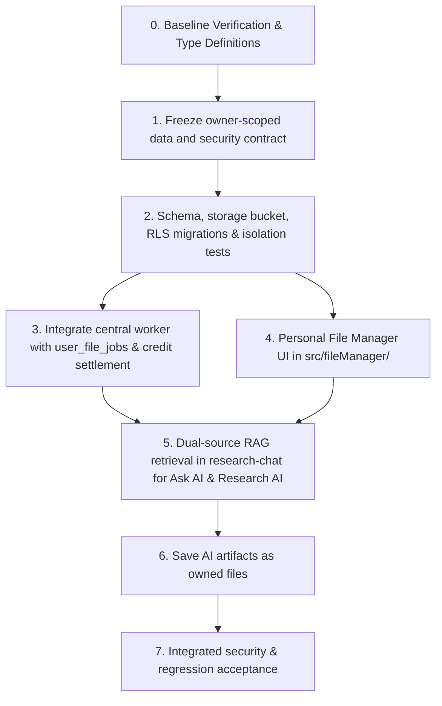

# Plan: private per-user File Manager and AI indexing

> **Status: Historical (2026-11-14).** From the contributor's file-manager branch (a4a09d84); records the branch's design as it stood then. Main's schema is F410–F413 (see `docs/specs/2026-11-26-file-manager-schema-adoption.md`), not the migrations this document describes.

> **Branch status: Approved for implementation — pending explicit implementation authorization.**
> Reconciled 2026-11-15 following the formal product sign-off, the
> [Ingestion & RAG Compatibility Audit](../research/2026-11-15-ingestion-rag-compatibility-audit.md),
> [ADR 0016](../decisions/0016-private-file-manager-ingestion-rag-integration.md), and the
> [Central Product Functionality Reference](../specs/private-file-manager-functionality.md).
> Approval of the document is not authorization to apply migrations, deploy,
> publish, upload real user files, or change production data.

Implements [the approved spec](../specs/2026-11-14-private-file-manager.md),
informed by the [integration audit](../research/2026-11-13-file-manager-integration-audit.md),
[compatibility audit](../research/2026-11-15-ingestion-rag-compatibility-audit.md), and
[functionality reference](../specs/private-file-manager-functionality.md).
The task is tracked as F341 (main: F419) in [open work](open-work.md).

## Architectural Baseline & Ingestion Refinements

- **PDF Confirmed for v1 Indexing**: Indexing is confirmed strictly for PDF files in v1. Non-PDF formats remain storage-only.
- **Explicit Indexing Trigger**: Upload and indexing are decoupled. Uploading a PDF does not auto-index. Indexing is initiated strictly via explicit user action (**"Index for AI"** button). (Recommended v1 behavior pending final product confirmation).
- **Subscription Quota Status**:
  - `free` (formerly Explorer): **500 MB** (Approved product limit).
  - `pro` (formerly Professional): **5 GB** (Approved product limit).
  - `plus` (new INR tier): **2 GB** (**Proposed mapping — pending explicit product confirmation**).
  - `max` (formerly Enterprise): **50 GB configurable** (**Proposed mapping — pending explicit product confirmation**).
  - Individual file upload limit: **50 MB** (Approved product limit).
  - Lapsed accounts evaluate dynamically via `my_entitlement()` to **500 MB** (Approved behavior).
- **Worker Fairness & Starvation Prevention**:
  - `public.user_file_jobs` is maintained as a dedicated table with client Realtime status subscriptions.
  - Concurrency is partitioned in `ingest_settings`: `corpus_max_running = 2`, `user_file_max_running = 2`, and `max_running_per_user = 1`.
  - Claim ordering checks user files first within their pool, falling back to corpus jobs; corpus ingestion is never starved.
  - Failures are capped at 3 attempts for user files (vs 6 for corpus) with rapid backoff and direct reflection to `user_files.index_error`.
  - OpenRouter embeddings (`openai/text-embedding-3-small`, 1536 dims) and Mistral OCR costs are attributed via `model_call_logs` and debited via `user_file_settle_credits`.
- **Deletion, Trash & Security Lifecycle**:
  - **30-Day Trash Default**: Trashing a folder or file sets `deleted_at = now()`, immediately invalidating RAG vector search (`match_user_files`).
  - Recursive folder deletion cascades `deleted_at` to all descendant folders and files. Child files retain individual retention timestamps.
  - Trash files continue counting against storage quota until permanently purged.
  - Hierarchy restoration revalidates index validity (`user_file_verify_index_validity`) before searchability is re-enabled. If parent folder was permanently purged, restored files relocate safely to root (`parent_id = NULL`) with a user notice.
  - **"Empty Trash" / Immediate Hard Purge**: An explicit user action requiring a high-friction confirmation dialog, explicit warning that recovery is impossible, strict ownership check `user_id = (SELECT auth.uid())`, cascading DB deletion (`user_file_chunks`, `user_file_jobs`, OCR pages), and immediate quota reclamation.
- **Citation Security & Signed URL Lifetime**:
  - Every private citation is revalidated at opening time via `document-file` for active ownership (`user_id = auth.uid()` and `deleted_at IS NULL`). Trashed files return 404.
  - Signed download URLs expire strictly in **60 seconds**.
  - Immediate RAG invalidation occurs instantaneously in PostgreSQL; already-issued signed URLs expire within their 60s token window.
  - Internal storage paths are never transmitted in chat SSE or citations; only opaque IDs are transmitted.
- **Unified Ask AI & Research AI Integration**:
  - Desk "✦ Ask AI" buttons and dock `AiPanel.jsx` both route to `research-chat`.
  - Default retrieval scope includes attached private files + shared research corpus.
  - Citations carry `source_origin: 'shared' | 'private'` and route PageViewer downloads to the `user-files` bucket.
- **Strict Tenant Isolation**: Enforce `(SELECT auth.uid())` via InitPlan RLS. Composite foreign key `(parent_id, user_id)` prevents cross-tenant hierarchy tampering. Zero admin bypass.

## Dependencies

Default is sequential. UI work may overlap only after the table/API contracts are frozen.

## Ordered implementation tasks

### 0. Baseline verification & type definitions
- **Write scope:** TypeScript interfaces under `src/types/fileManager.ts` and `supabase/functions/_shared/userFiles.types.ts`.
- Verify local disposable database baseline (`npm run test:sql`).
- Reconfirm plan entitlement enums (`public.app_plan`: `explorer`, `professional`, `enterprise`).

### 1. Freeze owner-scoped data/API contract and threat model
- **Write scope:** `docs/specs/2026-11-14-private-file-manager.md`, this plan, and SQL test design.
- Finalize DDL for `user_folders`, `user_files`, `user_file_chunks`, `user_file_jobs`, and storage bucket `user-files`.
- Finalize the two-user adversarial attack test matrix (T-1 to T-8).

### 2. Add personal file schema, private storage and RLS
- **Proposed write scope:**
  - One additive migration: `supabase/migrations/20261115000001_private_file_manager.sql`.
  - Focused disposable SQL test: `supabase/tests/database/user_files_isolation.test.sql`.
- **Implementation:**
  - Tables: `user_folders`, `user_files`, `user_file_chunks`, `user_file_jobs`.
  - Partitioned settings in `ingest_settings` (`corpus_max_running = 2`, `user_file_max_running = 2`, `max_running_per_user = 1`).
  - Constraints: Composite FK `(parent_id, user_id)` and storage path constraint.
  - Bucket: `user-files` (`public: false`, 50 MB limit).
  - Storage RLS: `(storage.foldername(name))[1] = (SELECT auth.uid()::text)`.
  - Table RLS: Owner-only CRUD via `(SELECT auth.uid())`.
  - Quota & Entitlement: `user_storage_quota_bytes(user_id)` mapping `public.app_plan` (`free`: 500 MB, `plus`: 2 GB, `pro`: 5 GB, `max`: 50 GB) and `user_file_prepare_upload` transaction lock.
  - RPCs: `user_file_prepare_upload`, `user_file_claim`, `user_file_advance`, `user_file_settle_credits`, and `match_user_files` (`SECURITY INVOKER`).
- **Gate:** SQL fixtures pass locally with zero vacuity failures. Cross-tenant reads return 0 rows. Quota overflow returns 402.

### 3. Integrate File Manager indexing with the central ingestion worker
- **Proposed write scope:**
  - `supabase/functions/ingest-worker/handler.ts` (poll user file jobs with fair share)
  - `supabase/functions/ingest-worker/user-file-step.ts` (private persistence adapter)
  - `supabase/functions/_shared/userFileDb.ts` (DB adapter for user files and chunks)
- **Implementation:**
  - Add `user_file_enqueue_indexing` RPC to place pre-flight credit hold and enqueue in `user_file_jobs`.
  - Extend worker loop in `ingest-worker/handler.ts` to poll `user_file_claim` with per-user fairness.
  - Reuse `ocrStep`, `planIndex`, and `embedTexts` without modifications.
  - Write resulting chunks into `user_file_chunks`, update `user_files.index_status = 'indexed'`, and settle credits.
- **Gate:** Deno tests prove own PDF indexes via worker; chunks persist to `user_file_chunks`; zero writes touch `documents` or `document_chunks`.

### 4. Build the user-facing File Manager
- **Proposed write scope:**
  - New module: `src/fileManager/` (adapted from `sources/src/components/agent-hub/drive/DriveBrowser.tsx`).
  - Navigation registration: `src/shell/AppShell.jsx` (or route registry).
  - Hook: `src/fileManager/useFileManager.js`.
- **Implementation:**
  - Folder navigation, breadcrumbs, upload dropzone, rename, move, delete (Trash), restore, and download.
  - Quota indicator showing consumed storage vs. plan tier limit.
  - Status pills showing upload progress and indexing state (`not_indexed`, `queued`, `indexing`, `indexed`, `failed`).
  - Context menu actions: "Index for AI", "✦ Ask AI", and "Move to Trash".
  - Multi-select bulk bar for batch move, delete, and index.
- **Gate:** File Manager operates cleanly on desktop and mobile viewports; real-time Supabase channels update indexing state without full page reload.

### 5. Attach personal files to Niyantran AI (Ask AI & Research AI Dual-Source RAG)
- **Proposed write scope:**
  - `src/ai/AiPanel.jsx` (file picker / attachment chip)
  - `src/lib/aiDrop.js` (materialize private file drops/seeds)
  - `src/ai/CitationBubble.jsx` & `src/ai/page-viewer/PageViewer.jsx` (private file download/viewer routing)
  - `supabase/functions/_shared/citation.types.ts`
  - `supabase/functions/_shared/retrieval.ts`
  - `supabase/functions/research-chat/validate.ts`
  - `supabase/functions/research-chat/prompt.ts`
  - `supabase/functions/research-chat/index.ts`
- **Implementation:**
  - Add `PrivateFileAttachment` (`kind: 'private_file'`, `file_id: string`) to `validate.ts`.
  - Desk "✦ Ask AI" buttons and File Manager "✦ Ask AI" seed `private_file` into `AiPanel.jsx`.
  - Extend `retrieval.ts` to call `match_user_files` alongside `match_documents`.
  - Merge returned chunks and tag with `source_origin: 'shared' | 'private'`.
  - Skip corpus-specific legal hydrators for private chunks in `research-chat/index.ts`.
  - Tag `TextCitation` with `source_origin` and `file_name`.
- **Gate:** Two-user test proves User A cannot search or cite User B's file. Citations verify with `text_hash`.

### 6. Save AI-created artifacts into File Manager
- **Proposed write scope:**
  - `src/ai/ArtifactSaveButton.jsx`
  - `src/fileManager/artifactService.js`
- **Implementation:**
  - Provide "Save to Files" action on generated tables, briefs, and code blocks.
  - Writes directly to `user_files` (`kind = 'artifact'`) inside the `AI Artifacts` folder (or user-chosen directory).
  - Generates content hash and saves payload to `user-files` storage bucket.
- **Gate:** Saved artifact appears in creator's File Manager and is inaccessible to peer accounts.

### 7. Integrated acceptance and handoff
- Run full regression test suite:
  - `npm test` (Vitest)
  - `deno test -A --config supabase/functions/deno.json supabase/functions`
  - `npm run test:sql` (disposable Postgres fixtures)
  - `npm run lint`
  - `npm run build`
- Verify zero regressions to existing legal corpus search, billing credit accounting, and admin ingestion.

## Rollback & Safety Strategy

If any deployment gate fails:
- Drop `user_folders`, `user_files`, `user_file_chunks`, `user_file_jobs`, and bucket `user-files`.
- Revert `ingest_settings` partitioned concurrency additions.
- Existing `documents`, `document_chunks_partitioned`, and `corpus` bucket remain completely untouched.
- Rollback executes cleanly in $< 5$ seconds without database locks on active shared corpus tables.
