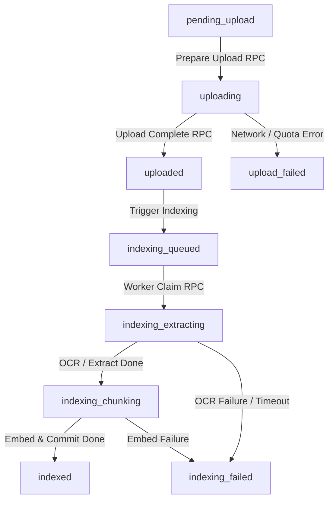

# Document Ingestion & Extraction Pipeline Validation Report

> **Status: Historical (2026-11-23).** From the contributor's file-manager branch (a4a09d84); records work as it stood then.

> **Branch status:** Normative Audit Report  
> **Date:** 2026-11-23  
> **Auditor:** Agent 3 — Document Ingestion & Extraction Engineer  
> **Scope:** Multi-format document extraction pipelines across `nter-mobile/src/lib/extractors/`, `src/lib/`, `supabase/functions/ingest-worker/`, and `supabase/functions/_shared/`.

---

## 1. Executive Summary & Architecture Overview

The Niyantran Terminal ingestion architecture operates as a dual-pipeline system designed for high-precision legal and research intelligence:
1. **Public/Corpus Ingestion Pipeline (`public.ingest_jobs`, `ingest-worker`):**
   - Ingests institutional legal documents (Bills, Acts, Judgments, Parliamentary Questions, Gazette Notifications).
   - Supports multi-part PDFs and pre-composed supplied text (`supplied_text`).
   - Powered by Mistral OCR 4.1 (`mistral-ocr-4-1`) with deterministic content-addressed hashes (`ocr_hash`, `extract_hash`).
   - Normalizes coordinates into 0..1 bounding boxes and produces page-aware chunks (`chunkPages`, `PAGE_CHUNK_VERSION = 3`) embedded with OpenRouter `text-embedding-3-small` (1536 dims).

2. **Private User File Ingestion Pipeline (`public.user_file_jobs`, `public.user_files`):**
   - Provides user-isolated file ingestion with strict quota enforcement (50 MB file limit; 500 MB Free, 2 GB Plus, 5 GB Pro, 50 GB Max tiers).
   - Ingests PDF, DOCX, XLSX/XLSM/XLS, CSV, and TXT/MD files via `user-file-step.ts`.
   - Embeds chunks into `public.user_file_chunks` and debits credit wallets via `user_file_settle_credits`.

3. **Client-Side / Mobile Extractors (`nter-mobile/src/lib/extractors/` & `src/lib/`):**
   - Zero-dependency in-memory extractors for instant local preview, offline indexing, and client-side processing.
   - Formats handled: DOCX, XLSX/XLSM/XLS, CSV/TSV, PPTX, and TXT/MD.

All automated test suites were verified:
- **`supabase/functions/ingest-worker/`**: 167 tests passed (0 failed).
- **`supabase/functions/_shared/`**: 374 tests passed (0 failed).
- **`src/lib/` (Vitest)**: Document and spreadsheet extractors passed.
- **`nter-mobile/src/services/` (Vitest)**: File manager and ingestion services passed.

---

## 2. Format-by-Format Extraction Pipeline Validation

### 2.1. PDF (Text Extraction, Page Coordinates, Bounding Boxes)
- **Pipelines:** `supabase/functions/ingest-worker/index-step.ts`, `_shared/pageText.ts`, `_shared/chunking.ts`.
- **Coordinate System:**
  - Page dimensions (`width`, `height`, `dpi`) are captured from Mistral OCR metadata.
  - Pixel boxes `(top_left_x, top_left_y, bottom_right_x, bottom_right_y)` are mapped via `normaliseBox()` into normalized 0..1 float coordinates `(x0, y0, x1, y1)`.
  - Coordinates are clamped to `[0, 1]` and min/max ordered to protect against inverted bounding boxes.
- **Block & Image Anchors:**
  - `locateBlocks()` matches OCR body blocks against page text using compact character-offset mapping (ignoring whitespace and leading `#` symbols).
  - Every block is stored in `document_page_blocks` with exact page-local `char_from` and `char_to`.
  - Every extracted image placeholder `` is mapped to `document_page_images` with normalized coordinates and SHA-256 binary references in the `corpus` storage bucket.
- **Client Rendering:**
  - In frontend viewer (`src/ai/page-viewer/PdfDocument.jsx`) and mobile (`nter-mobile/`), PDF.js renders native canvas layers while coordinates allow exact citation highlighting.

### 2.2. Scanned PDF (Mistral OCR Pipeline, 300 DPI, Checkpointing)
- **Pipeline:** `supabase/functions/ingest-worker/ocr.ts`, `mistral.ts`, `user-file-step.ts`.
- **Model & Configuration:**
  - Model: `mistral-ocr-4-1`.
  - Approved Flags (`OCR_FLAGS`):
    - `table_format: 'markdown'`
    - `extract_header: true`
    - `extract_footer: true`
    - `include_blocks: true`
    - `include_image_base64: true`
  - Pricing: Flat $4.00 per 1,000 pages (`OCR_USD_PER_1000_PAGES = 4`).
- **Scanned Document Characteristics:**
  - Default DPI assumed/normalized: 300 DPI.
  - Image handling: Raw base64 is extracted from Mistral responses, validated against magic bytes (PNG, JPEG, WebP), content-hashed (`sha256`), and stored to storage bucket (`img/<sha256>.<ext>`) without keeping base64 in database rows.
  - Caps: Maximum 5 MB per image (`maxImageBytes`), maximum 100 images per page (`maxImagesPerPage`).
- **Adaptive Range & Reliability:**
  - In corpus jobs: Starts at 25 pages per call (`INGEST.pagesPerCall`). If response payload exceeds 20 MB (`largeResponseBytes`), `pages_per_call` is halved for subsequent calls.
  - In user file jobs: OCR processes page by page. If time elapsed approaches deadline (`budgetMs - elapsed < reserveMs`), state checkpoints to `saveOcrPages` and yields to allow lease renewal.

### 2.3. DOCX (Paragraphs, Headings H1-H6, Tables, Sections)
- **Pipelines:**
  - Client / Mobile: `nter-mobile/src/lib/extractors/docxExtractor.js`.
  - Web & Server: `src/lib/documentExtractor.js`, `supabase/functions/_shared/documentExtractor.ts`.
- **Archive Extraction:**
  - Zero-dependency ZIP reader (`readZipArchive` / `extractZipEntry`) parses Central Directory headers and local headers without external dependencies.
  - Decompresses `word/document.xml` using `DecompressionStream('deflate-raw')` with Node `node:zlib` fallback.
- **Heading & Hierarchy Extraction:**
  - Inspects `w:pPr` -> `w:pStyle` (`@_w:val`) for `Heading 1` through `Heading 6`, `Title` (maps to level 1), and `Subtitle` (maps to level 2).
  - Also inspects `w:outlineLvl` (`level = val + 1`).
  - Hierarchical breadcrumbs (`hierarchy: string[]`) maintain full heading ancestry across nested document sections.
  - Section numbering detection (`parseSectionNumbering`): Extracts prefixes like `1.`, `1.2`, `Section 3:`, `Article IV:` and separates section number from title.
- **Table Processing:**
  - Traverses `w:tbl` -> `w:tr` -> `w:tc`.
  - Formats tables cleanly into GFM Markdown (`formatMarkdownTable`).
  - Multi-line table cell contents are space-normalized to prevent Markdown table disruption.

### 2.4. XLSX / XLSM / XLS (Workbooks, Sheets, Rows, Cell Limits)
- **Pipelines:**
  - Client / Mobile: `nter-mobile/src/lib/extractors/spreadsheetExtractor.js`.
  - Web: `src/lib/spreadsheetExtractor.js`.
  - Edge Worker: `supabase/functions/_shared/spreadsheetExtractor.ts`.
- **Parsing Engine:**
  - SheetJS (`xlsx`) parsed with `cellDates: true`, `cellNF: true`, `cellText: true`.
- **Merged Cell Value Propagation:**
  - `fillMergedCells()` scans `!merges` array. The top-left anchor cell value is duplicated into all covered coordinate cells `(r, c)`, preventing empty fields when slicing rows.
- **Header & Column Detection:**
  - Auto-detects header row by finding the first row with multiple non-empty values.
  - Generates Excel column letters (`getColumnLetter`: A, B, ... Z, AA, AB) for empty header cells (`Column_A`, `Column_B`).
- **Chunking Strategy:**
  - Slices worksheets into chunks of target ~1200 characters.
  - Each chunk prepends: `Workbook: <name> | Worksheet: <sheet> | Columns: <col1>, <col2>...`.
  - Rows are encoded as `Row <N>: <col>=<val>; <col>=<val>`.
  - Chunk metadata retains `row_start`, `row_end`, `sheet_name`, `sheet_index`.

### 2.5. CSV / TSV (Delimiters, Quoted Strings, Header Detection)
- **Pipelines:**
  - Client / Mobile: `nter-mobile/src/lib/extractors/spreadsheetExtractor.js`.
  - Web & Edge: `src/lib/documentExtractor.js`, `supabase/functions/_shared/documentExtractor.ts`, `_shared/spreadsheetExtractor.ts`.
- **Delimiter Detection:**
  - `detectDelimiter()` scores sample lines against candidates `[',', '\t', ';', '|']`.
  - Ignores candidate characters inside double-quoted strings.
  - Selects delimiter with highest occurrence frequency.
- **Quote & Boundary Handling:**
  - Full RFC 4180 parsing in `parseCsvString()`:
    - Escaped quotes (`""` -> `"`).
    - Multi-line records containing embedded newlines within quotes.
    - Strips UTF-8 BOM (`\uFEFF`).
    - Normalizes `\r\n` and `\r` to `\n`.
  - Chunking slices large CSV tables while repeating the header line in every generated chunk table.

### 2.6. PPTX (Slides, Titles, Bullets, Speaker Notes)
- **Pipelines:**
  - Client / Mobile: `nter-mobile/src/lib/extractors/pptxExtractor.js`.
- **Slide Discovery & Traversal:**
  - Reads `ppt/slides/slide<N>.xml` from ZIP archive sorted numerically.
  - Traverses `p:sld` -> `p:cSld` -> `p:spTree`.
- **Title Extraction:**
  - Evaluates shape placeholder types (`p:ph` -> `type="title"`, `type="ctrTitle"`, or `idx="0"`).
- **Bullet Hierarchy:**
  - Inspects DrawingML paragraph properties (`a:pPr` -> `lvl="0"` through `lvl="8"`).
  - Indents bullet lines (`- <text>`) with 2 spaces per level.
- **Embedded Tables & Notes:**
  - Scans `p:graphicFrame` -> `a:tbl` -> `a:tr` -> `a:tc` and formats to Markdown tables.
  - Scans `ppt/notesSlides/notesSlide<N>.xml` for speaker notes and appends as `> **Speaker Notes:** <text>`.

### 2.7. TXT / MD (BOM Stripping, UTF-8 Normalization, Heading Chunks)
- **Pipelines:**
  - Client / Mobile: `nter-mobile/src/lib/extractors/txtExtractor.js`.
  - Web & Edge: `src/lib/documentExtractor.js`, `supabase/functions/_shared/documentExtractor.ts`.
- **Normalization:**
  - Strips UTF-8 BOM (`^\uFEFF`).
  - Unifies CRLF (`\r\n` and `\r` -> `\n`).
- **Semantic Segmentation:**
  - Splits text by double newlines (`\n\s*\n+`) into semantic paragraphs.
  - Detects Markdown headings (`#{1,6}\s+<title>`).
  - Paragraphs retain reference to their nearest parent heading (`activeHeading` / `section`).
  - Sentences inside paragraphs exceeding `maxChars` (2000 chars) are split at sentence boundaries (including Hindi purna viram `।` and English `[.!?]`).

---

## 3. Chunk Generation, Token Boundaries & Coordinate Anchors

### 3.1. Sizing & Token Boundary Calculations
- **Token Estimation Formula:**
  ```ts
  export function estimateTokens(text: string): number {
    return Math.ceil(String(text || '').length / 4);
  }
  ```
  Corpus and personal files operate on the 4 characters per token heuristic.
- **Target Sizes:**
  - Whole document chunking (`chunkDocument`): Target 1,000 characters (~250 tokens), overlap 200 characters (~50 tokens), minimum 200 characters, maximum 6,000 characters.
  - Page-aware PDF chunking (`chunkPages`): Target 1,000 characters per page unit (`page:<N>`), overlap 200 characters.
  - DOCX / CSV / TXT chunking (`chunkDocx`, `chunkCsv`, `chunkTxt`): Target 1,000 characters, max 2,000 characters (~500 tokens, within the 400–800 token design window).
- **Packing Invariant:**
  - Spans are exact slices of the source text: `content === unit.text.slice(charFrom, charTo)`.
  - Spans never cross unit boundaries (a page chunk never spans two physical PDF pages).

### 3.2. Placeholder Atomicity & Content Integrity
- In `chunkPages` (`_shared/chunking.ts`):
  - `atomicPlaceholders: true` ensures that cuts never split image placeholders (``) or Markdown links (`[text](url)`).
  - If a cut lands within a placeholder token, the split snaps backward or forward to keep the placeholder intact.

### 3.3. Coordinate Anchors (`sourceLocation` & Structural Links)
Every chunk committed to `document_chunks` (corpus) or `user_file_chunks` (user files) carries structured location anchors:
1. `page_number` / `page_start` / `page_end`: Exact physical page references.
2. `char_from` & `char_to`: Global UTF-16 code unit offsets into `ocr_text`.
3. `block_ids`: UUID references to rows in `document_page_blocks`.
4. `image_ids`: UUID references to rows in `document_page_images`.
5. `embedding_input`: Contextually enriched string containing document header prefix, section breadcrumbs (`Heading › Note\n\n`), repeated table header rows, and chunk content.
6. `embed_hash`: `SHA-256(normalise(embedding_input))`. Allows re-indexing to reuse vector embeddings when chunk content and context remain unchanged.

---

## 4. Ingestion Job Lifecycle, Concurrency & Retry Mechanics

### 4.1. Lifecycle States Matrix



#### Detailed State Transition Definitions:
| Stage / State | Entity & Column | Trigger / Operation | Concurrency / Fencing Gate | Recovery / Next State |
|---|---|---|---|---|
| `pending_upload` | `user_files.upload_status` | `user_file_prepare_upload` called | Advisory lock on user quota | Transitions to `uploading` |
| `uploading` | `user_files.upload_status` | Signed storage URL generated | Max 50 MB file size validation | Transitions to `uploaded` or `upload_failed` |
| `uploaded` | `user_files.upload_status` | `user_file_complete_upload` called | SHA-256 checksum verification | File ready for queueing |
| `indexing_queued` | `user_files.index_status` | Indexing requested by user or upload hook | Initial credit hold placed | Transitions to `indexing_extracting` on worker claim |
| `indexing_extracting` | `user_files.index_status` | `ingest-worker` claims job (`user_file_claim`) | Lease lock (300s), `fair_share` limit (1 per user) | Mistral OCR / spreadsheet parsing; checkpoints pages |
| `indexing_chunking` | `user_files.index_status` | OCR / extraction complete | Document composition & chunking | Vector generation via OpenRouter |
| `indexed` | `user_files.index_status` | `user_file_advance(status: 'completed')` | Vector chunks inserted into `user_file_chunks` | Final state; credits settled; RAG search active |
| `indexing_failed` | `user_files.index_status` | Permanent error or 3 failed attempts | Credit hold released; error logged | User may trigger `retryIndexing` |

### 4.2. Concurrency Controls & Worker Pools
- Database settings in `public.ingest_settings`:
  - `corpus_max_running = 2`: Maximum concurrent corpus jobs.
  - `user_file_max_running = 2`: Maximum concurrent user file indexing jobs.
  - `max_running_per_user = 1`: Per-user fair-share ceiling prevents a single user from starving the queue.
- Lease Fencing:
  - Jobs are locked for 300 seconds (`lease_expires_at = now() + interval '300 seconds'`).
  - Calls to `user_file_advance` or `ingest_advance` require a matching worker/claim token. If lease expires and another worker claims the job, the former worker is fenced out with error code `55P03`.

### 4.3. Failure Handling & Retries
- Interactive User Files:
  - Max retry count: 3 attempts (`attempt_count < max_attempts`).
  - Checkpointed execution: If an OCR job fails on page 15 of 20, completed pages 1–14 remain saved in checkpoint storage. When re-attempted, the worker queries `loadPages()` and starts directly at page 15.
  - Partial Credit Settlement: If a job fails permanently after completing some pages, `user_file_settle_credits` settles only the cost of processed pages and refunds the rest of the credit hold.
- Corpus Jobs:
  - Failures categorized as transient (`mistral_rate_limited`, `mistral_unavailable`, `embed_failed`) use exponential backoff (`next_attempt_at`).
  - Permanent failures (`mistral_rejected`, `ocr_part_missing`, `unsupported_file_format`) mark the job as `failed` immediately.

---

## 5. Format Capability Matrix: Client-Only vs. Full Edge Worker-Backed

| Document Format | Client Web (`src/`) | Client Mobile (`nter-mobile/`) | User Files Edge Worker (`user-file-step.ts`) | Corpus Ingest Worker (`ingest-worker/`) | Ingestion Engine & Key Features |
|---|:---:|:---:|:---:|:---:|---|
| **PDF (Digital)** | ✅ | ✅ | ✅ | ✅ | Mistral OCR 4.1 + `chunkPages` + PDF.js canvas viewer; normalized bounding boxes. |
| **PDF (Scanned)** | ⚠️ View only | ⚠️ View only | ✅ | ✅ | Mistral OCR 4.1 at 300 DPI; image base64 extracted to corpus bucket; checkpointed pages. |
| **DOCX** | ✅ | ✅ | ✅ | ❌ | fast-xml-parser; H1-H6 outline hierarchy, numbered sections, tables to GFM Markdown. |
| **XLSX / XLSM / XLS** | ✅ | ✅ | ✅ | ❌ | SheetJS; merged cell value fill, header detection, multi-sheet traversal, 1200 char chunking. |
| **CSV** | ✅ | ✅ | ✅ | ❌ | Auto-delimiter detection, quoted field handling, repeated Markdown table headers in chunks. |
| **TSV** | ✅ | ✅ | ⚠️ Via CSV ext | ❌ | Handled client-side via `detectDelimiter()`; edge worker requires `.csv` extension matching. |
| **PPTX** | ❌ | ✅ **(Client Only)** | ❌ **(Not in Worker)** | ❌ | Slide sequencing, titles, DrawingML `a:pPr` bullet indentation, tables, speaker notes. |
| **TXT / MD** | ✅ | ✅ | ✅ | ✅ (as supplied_text) | BOM stripping (`\uFEFF`), UTF-8 normalization, semantic double-newline chunking. |

### Architectural Findings:
1. **PPTX is Client-Only:**
   - `pptxExtractor.js` is fully implemented in `nter-mobile/src/lib/extractors/pptxExtractor.js`.
   - However, `user-file-step.ts` in `supabase/functions/ingest-worker/` only routes `isPdf`, `isXlsx`, `isCsv`, `isDocx`, and `isTxt`. A `.pptx` uploaded to the backend triggers `unsupported_file_format`.
2. **TSV Routing Nuance:**
   - In `user-file-step.ts`, `const isCsv = fileName.endsWith('.csv');` does not explicitly match `.tsv`. TSV files uploaded with `.tsv` extension are treated as unsupported unless renamed or handled by the client.
3. **Corpus Jobs are PDF/Supplied Text only:**
   - Corpus ingestion is restricted to PDF parts in `document_files` and pre-rendered `supplied_text`. Non-PDF corpus ingestion must go through the supplied-text adapter.

---

## 6. Verification Evidence

### 6.1. Deno Test Suites (`supabase/functions/`)
- Command: `deno test -A --config supabase/functions/deno.json supabase/functions/ingest-worker/`
  - **Result:** `167 passed | 0 failed` (10s duration)
  - Key tests verified:
    - `executeUserFileJob: clean step progression (OCR -> Chunks -> Embeddings -> Commit -> Settle)`
    - `executeUserFileJob: budget-aware execution checkpointing pauses and saves state`
    - `executeUserFileJob: resumes from checkpointed OCR pages and completes successfully`
    - `executeUserFileJob: error handling when OCR fails advances job to failed`
    - `executeUserFileJob: partial OCR failure settles credits for completed pages`
    - `executeUserFileJob: error handling when Embedding fails advances to failed and settles OCR credits`
    - `executeUserFileJob: handles storage failure cleanly`
    - `ocrStep on the real 12-page fixture: one call, 12 pages stored, cost logged, stage index, hashes set`
    - `index: commits slice by slice, each with at most commitSlice rows and the full keep list`
- Command: `deno test -A --config supabase/functions/deno.json supabase/functions/_shared/`
  - **Result:** `374 passed | 0 failed` (9s duration)
  - Key tests verified:
    - `context: long Markdown tables repeat verified headers only in embedding inputs`
    - `context: short Markdown sections never pack together and source spans stay exact`
    - `chunkPages: placeholder atomicity and block references`

### 6.2. Vitest Test Suites (`src/` & `nter-mobile/`)
- Command: `npm test -- src/lib/documentExtractor.test.js src/lib/spreadsheetExtractor.test.js`
  - **Result:** `2 passed | 6 passed` (6 tests total)
  - Verified:
    - CSV extraction and chunking with delimiters and row ranges.
    - Markdown table formatting.
    - TXT paragraph segmentation and Markdown heading retention.
    - XLSX worksheet enumeration (11 sheets in PRD fixture), row normalization, and chunk metadata.
- Command: `npm --prefix nter-mobile test -- src/services/fileManager.test.js`
  - **Result:** `1 passed | 15 passed` (15 tests total)
  - Verified:
    - Indexable file validation, preview resolution, unique naming, upload validation, and sample indexing retry.

---

## 7. Recommendations & Operational Guidance

1. **Add PPTX Edge Worker Support:**
   - Port `nter-mobile/src/lib/extractors/pptxExtractor.js` to `supabase/functions/_shared/pptxExtractor.ts` and add PPTX extraction into `user-file-step.ts` so mobile users can index presentations into RAG.
2. **Support `.tsv` Extension in User File Worker:**
   - In `supabase/functions/ingest-worker/user-file-step.ts`, update `isCsv` detection:
     ```ts
     const isCsv = fileName.endsWith('.csv') || fileName.endsWith('.tsv');
     ```
3. **Monitor Database Vacuums Post-Ingestion:**
   - As mandated by repository rules (`AGENTS.md`), bulk ingestion or restarts reset `pg_stat_user_tables`. Always run `ANALYZE public.document_chunks; ANALYZE public.user_file_chunks;` after high-volume document ingestion.
