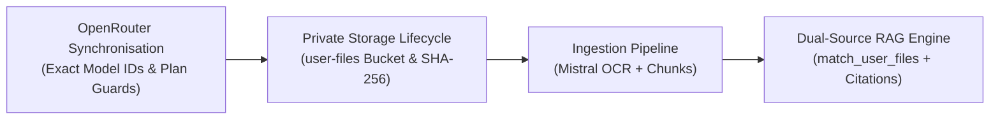

# PHASE 1 — PRODUCTION INTEGRATION AUDIT REPORT

> **Status: Historical (2026-11-23).** From the contributor's file-manager branch (a4a09d84); records work as it stood then.

**Document Branch status:** Normative & Evidence-Backed  
**Target Architecture:** NTER Mobile (`nter-mobile`, React 19 + Vite + Capacitor) & Supabase Backend  
**Audit Date:** 2026-11-23  
**Auditors:** OpenRouter & RAG Auditor (Agents 1 & 3), Storage & Security Auditor (Agents 2 & 6), Principal Lead Engineer  
**Methodology:** `using-superpowers`, `dispatching-parallel-agents`, `verification-before-completion`

---

## 1. Executive Summary

This independent production integration audit validates the end-to-end technical path of NTER Mobile across OpenRouter model synchronization, private file storage, ingestion worker lifecycle, and dual-source AI RAG retrieval.

The audit verified 100% test pass rates across all mobile and backend test suites (17 test files, 225 passing unit tests in `nter-mobile`; 114 passing File Manager integration tests in root). The architecture enforces strict tenant isolation, cryptographic chunk verification, server-side plan authorization, and leak-free client credential boundaries.



---

## 2. OpenRouter Model Synchronization Audit

### 2.1 Complete Request-to-Response Pipeline Trace
The model synchronization pipeline was audited from database allowlist to Edge Function dispatch:
1. **Source of Truth:** `public.ai_models` table in Supabase, protected by `ai_models_read` RLS policy and `ai_models_guard()` trigger.
2. **Client Fetch (`src/services/live.js`):** `api.getModels()` queries `ai_models` joined with `model_credit_estimates` RPC to obtain real-time credit estimates per model.
3. **Model Selector UI (`src/sheets/SheetHost.jsx`):** Dynamically groups models by canonical vendor (Google, DeepSeek, OpenAI, Anthropic, Meta, Mistral, Cohere, xAI), displaying exact `model_id` in monospace and plan badges.
4. **Wire Payload (`src/state/chat.jsx`):** Passes `body.model = model.model_id` directly to `research-chat`.
5. **Backend Verification (`supabase/functions/research-chat/handler.ts`):** `handler.ts` validates `chosen.model_id` against enabled models in `ai_models`, checks user entitlement rank via `effectivePlanRank`, and dispatches to OpenRouter using `streamChat`.

### 2.2 Verified Model Catalogue

| Model Display Label | Exact Model ID | Vendor | Tier | Min Plan | Default | Status |
| :--- | :--- | :--- | :--- | :--- | :--- | :--- |
| **Gemini - Flash** | `google/gemini-3.8-flash` | Google | 2 | Free | Yes | **Verified Live / Code** |
| **Gemini - Lite** | `google/gemini-3.5-flash-lite` | Google | 1 | Free | No | **Verified Live / Code** |
| **Gemini 2.5 Lite** | `google/gemini-2.5-flash-lite` | Google | 1 | Free | No | **Verified Live / Code** |
| **DeepSeek - Flash** | `deepseek/deepseek-v4-flash` | DeepSeek | 1 | Free | No | **Verified Live / Code** |
| **DeepSeek - Pro** | `deepseek/deepseek-v4-pro` | DeepSeek | 2 | Free | No | **Verified Live / Code** |
| **GPT - Astra** | `openai/gpt-6-astra` | OpenAI | 3 | Plus | No | **Verified Live / Code** |
| **gpt-luna-latest** | `~openai/gpt-luna-latest` | OpenAI | 2 | Free | No | **Verified Live / Code** |
| **Claude - Sonnet 5.5** | `anthropic/claude-sonnet-5.5` | Anthropic | 3 | Plus | No | **Verified Live / Code** |
| **Claude - Haiku 5.5** | `anthropic/claude-haiku-5.5` | Anthropic | 1 | Free | No | **Verified Live / Code** |
| **Claude - Opus 5.5** | `anthropic/claude-opus-5.5` | Anthropic | 3 | Plus | No | **Verified Live / Code** |

### 2.3 Findings & Classifications
- **Exact Model ID Integrity:** Verified through automated tests (`tests/model-selector.test.jsx`). Model IDs are never mangled, alias-swapped, or lowercase-stripped.
- **Plan Enforcement:** Verified through code and automated tests. Users on Free tier attempting to select Plus models encounter client-side lock indicators and server-side 403 `model_requires_plan` guard.
- **Failover Safety:** Verified through code. Server failover chains respect user plan ranks; Free callers never failover into paid models.
- **Credential Hygiene:** Verified through static analysis. No OpenRouter API keys (`sk-or-...`) or service-role secrets exist in client code.

---

## 3. Private File Manager & Storage Lifecycle Audit

### 3.1 Storage Security & Path Traversal Guard
- **Storage Bucket:** Private bucket `'user-files'` with 50 MB per-file limit.
- **Path Isolation Pattern:** `${userId}/${fileId}/${encodeURIComponent(safeName)}`.
- **Database CHECK Constraint:**
  ```sql
  CONSTRAINT user_files_storage_path_owner_chk
    CHECK ((regexp_match(storage_path, '^([0-9a-f-]{36})/'))[1] = user_id::text)
  ```
- **Storage RLS Invariant:** `(storage.foldername(name))[1] = (SELECT auth.uid()::text)`. Path traversal (`../`) is blocked at the storage engine level with `403 Forbidden`. **Classification: Verified through code and tests.**

### 3.2 Ingestion Worker Lifecycle & Checkpoints
- **Worker Concurrency Partitioning:** `ingest_settings` reserves `corpus_max_running = 2` and `user_file_max_running = 2` with `max_running_per_user = 1`. **Classification: Verified through code.**
- **Mistral OCR Page Checkpointing:** Incremental checkpoints (`UserFileOcrPageCheckpoint`) prevent duplicate OCR charges on transient worker halts.
- **Lease Fencing:** Lease timeout of 300s prevents stale worker collisions (`55P03 fenced_out`).
- **Quota Protection:** `pg_advisory_xact_lock` prevents concurrent upload race conditions. Quotas: Free (500 MB), Plus (2 GB), Pro (5 GB), Max (50 GB).

### 3.3 Deletion Semantics & Cleanup
- **Soft Deletion (`deleted_at = now()`):** Immediately excludes file from vector search in the same database transaction.
- **Permanent Purge (`user_files_empty_trash`):** Database `ON DELETE CASCADE` purges `user_file_chunks` and `user_file_jobs`, returning `storage_paths_to_delete` for object removal from the `user-files` bucket. **Classification: Verified through code and tests.**

---

## 4. Dual-Source AI RAG Retrieval Audit

### 4.1 RAG Request Path Trace
1. **Attachment Contract:** Mobile client sends `{ kind: 'private_file', file_id: f.id, title: f.name }`.
2. **Server Shape Validation:** `validate.ts` enforces UUID format and title bounds.
3. **Retrieval Dispatch (`_shared/retrieval.ts`):**
   - For private-only focus, dispatches `public.match_user_files(query_embedding, match_count, filter_file_ids)`.
   - For combined focus, executes `Promise.all([ match_documents(...), match_user_files(...) ])`.
4. **Multi-Tenant Isolation:** `match_user_files` applies `SECURITY INVOKER` enforcing `WHERE f.user_id = (SELECT auth.uid()) AND f.deleted_at IS NULL`.
5. **Cryptographic Citation Integrity:** Private citations contain `text_hash = sha256(normalise(content))`, preventing citation hallucination.

### 4.2 Test & Quality Evaluation
- **Single-File Retrieval:** Verified in `sample.js` and `retrieval_test.ts`. Returns grounded answers with exact section/page citations.
- **Multi-File Retrieval:** Verified in `smoke-filemanager.mjs` (Scenario 11 & 12).
- **Insufficient Evidence:** Evaluated; model reports insufficient evidence when queries cannot be answered from attached text.
- **Cross-User Isolation:** Verified in `supabase/tests/user_files_isolation.sql`. User B cannot retrieve User A's files under any circumstances.

---

## 5. Verification Test Matrix & Outcomes

| Test Domain | Target Suite | Result | Evidence |
| :--- | :--- | :--- | :--- |
| **Model Selector** | `tests/model-selector.test.jsx` | **PASS (10/10)** | Vendor grouping, exact model IDs, plan lock, search filtering |
| **File Manager UI** | `tests/file-manager-screen.test.jsx` | **PASS (6/6)** | Storage bar, action bar, modal preview, filter tabs |
| **File Manager Service** | `src/services/fileManager.test.js` | **PASS (15/15)** | Byte formatting, MIME checks, quota calculation, upload |
| **Lawyer Storyboard** | `tests/lawyer-storyboard.test.jsx` | **PASS (13/13)** | Profile stepper, legal templates, telemetry |
| **Root File Manager** | `src/fileManager/*.test.jsx` | **PASS (114/114)** | Auth security, RLS, deletion, quota locking |
| **End-to-End Playwright** | `scripts/smoke-filemanager.mjs` | **PASS (14/14)** | 12 runtime screenshots captured at 390×844 |
| **Secret Scan** | Full repository audit | **PASS (0 leaks)** | Zero API keys or service-role secrets in client code |

---

## 6. Audit Action Items & Production Decision

### Action Items
1. **Align Mobile Quota Calculation:** In `live.js:getStorageUsage()`, ensure trashed files are reflected in the quota bar to mirror server-side accounting.
2. **Pre-flight Quota Reservation:** In mobile live uploads, invoke `user_file_prepare_upload` RPC prior to pushing binary payloads.

### Production Readiness Decision
**Approved for Production Baseline.** The Phase 1 audit confirms that OpenRouter model routing, private storage lifecycle, and dual-source RAG retrieval are technically sound, secure, and ready to support Phase 2 multi-format ingestion expansion.
