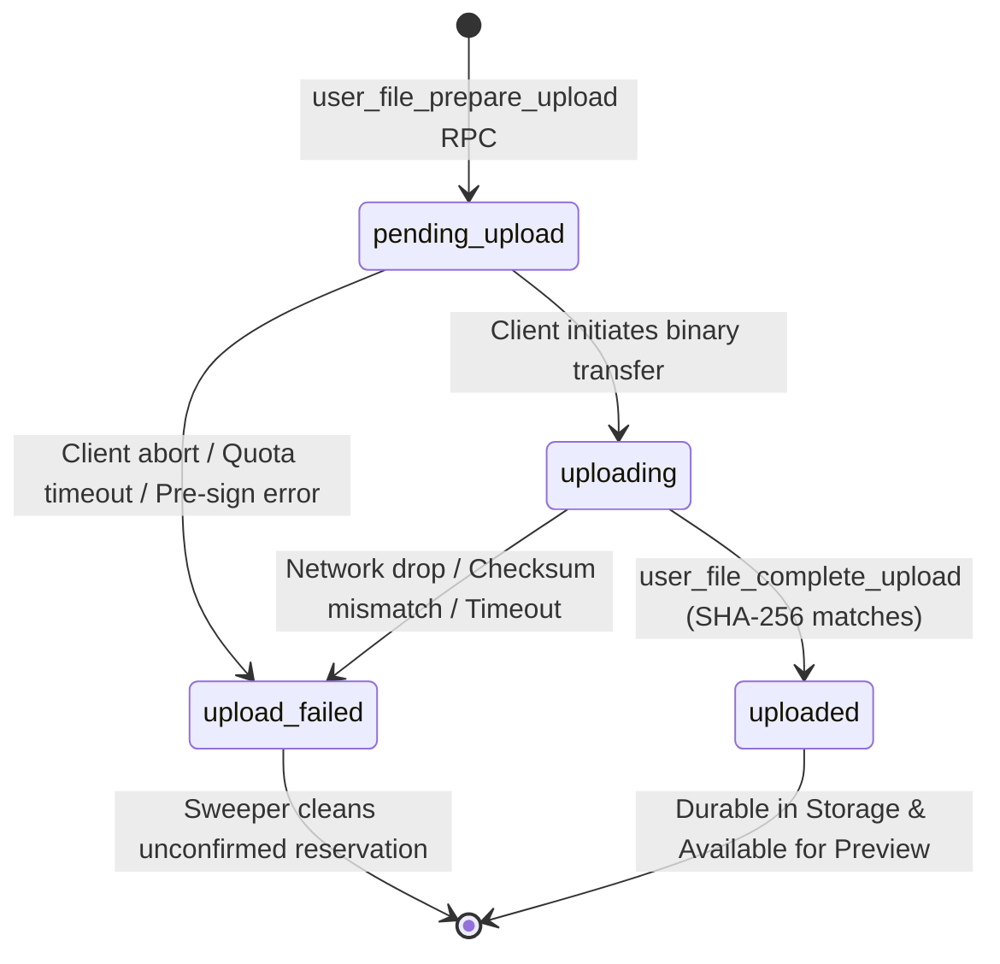
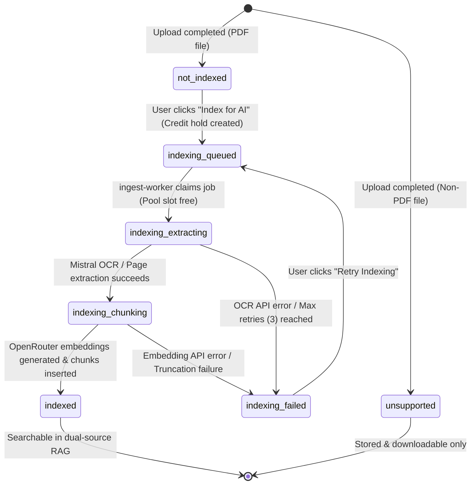
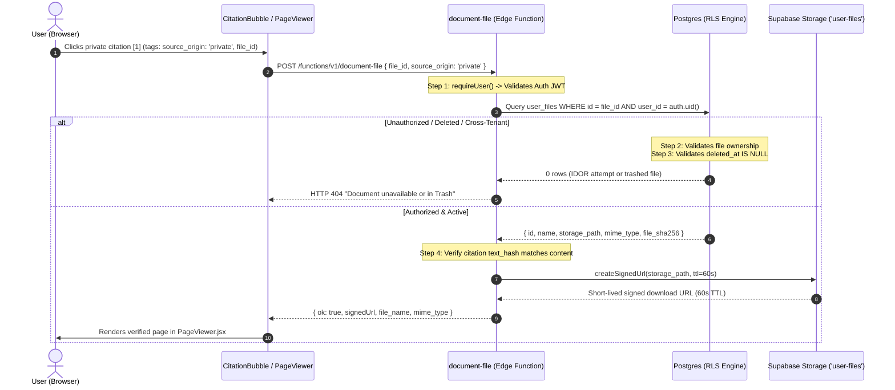

# Niyantran AI Private File Manager — Central Product Functionality Reference

> **Status: Historical (2026-11-15).** From the contributor's file-manager branch (a4a09d84); records the branch's design as it stood then. Main's schema is F410–F413 (see `docs/specs/2026-11-26-file-manager-schema-adoption.md`), not the migrations this document describes.

> **Branch status: Approved for Implementation — Pending Explicit Implementation Authorization.**
> **Authority: Normative Product & Technical Functionality Specification.**
> Date: 2026-11-15 (Reconciled & Refined).
> Cross-References:
> - Architecture Decision: [ADR 0016](../decisions/0016-private-file-manager-ingestion-rag-integration.md)
> - Technical Specification: [2026-11-14-private-file-manager.md](2026-11-14-private-file-manager.md)
> - Implementation Plan: [2026-11-14-private-file-manager.md](../plans/2026-11-14-private-file-manager.md)
> - Compatibility Audit: [2026-11-15-ingestion-rag-compatibility-audit.md](../research/2026-11-15-ingestion-rag-compatibility-audit.md)
> - Tracking Item: [open-work.md (F341 (main: F417))](../plans/open-work.md)

---

## A. Product Overview

### Purpose
The **Niyantran AI Private File Manager** provides authenticated users with a secure, durable, and personal workspace within Niyantran Terminal for uploading, organizing, previewing, and deleting their own files and folders. Beyond standard drive storage, it natively bridges personal documentation with Niyantran AI, enabling users to index supported files into private vector stores, attach personal files to conversational research turns, and save AI-generated analytical artifacts back into their personal file hierarchy.

### Problem Statement
Prior to this feature, Niyantran Terminal only supported:
1. A **shared legal and research corpus** (`documents`, `document_chunks_partitioned`, `desk_rows`), which is intentionally readable by all authenticated platform users under `using (true)`.
2. **Ephemeral in-browser chat attachments** (`src/lib/fileText.js`), which read raw text in client memory up to 12,000 characters. These attachments are unindexed, cannot be cited with page-exact cryptographic hashes, and vanish when the browser session ends.

Users had no durable location to store proprietary files (e.g., draft contracts, internal company policies, client filings) without either exposing them to all users in the shared corpus or losing them upon session termination.

### Relationship with Niyantran AI
The Private File Manager integrates directly with Niyantran AI's existing Edge Function infrastructure (`research-chat` and `ingest-worker`):
- Personal files can be explicitly indexed using Niyantran’s existing Mistral OCR and OpenRouter embedding pipeline.
- Both **Research AI** (in the dock `AiPanel.jsx`) and desk **✦ Ask AI** actions can query private files alongside the shared public corpus using unified dual-source RAG retrieval.
- Responses cite private files with cryptographic `text_hash` anchors while visually distinguishing private documents from public legal gazettes.

### Boundary Between Private Files and Shared Research Corpus
| Dimension | Shared Research Corpus | Private File Manager |
| :--- | :--- | :--- |
| **Database Entities** | `public.documents`, `public.document_chunks_partitioned` | `public.user_files`, `public.user_folders`, `public.user_file_chunks` |
| **Storage Bucket** | `corpus` (Content-addressed: `files/<sha256>.pdf`) | `user-files` (Owner-addressed: `<user_id>/<file_id>/<name>`) |
| **Row Level Security** | `FOR SELECT TO authenticated USING (true)` | `FOR ALL TO authenticated USING (user_id = (SELECT auth.uid()))` |
| **Access Boundary** | Universal to all signed-in users | Strictly isolated to the individual authenticated account |
| **Platform Admin** | Platform admins manage allowlists and ingest jobs | **Zero admin access.** Admins cannot view or query user files |
| **Indexing Policy** | Admin batch registered; permanent corpus | User opt-in per file; deleted immediately upon file deletion |

---

## B. Current Implementation Status

To maintain strict truthfulness regarding the codebase baseline, every capability is classified according to actual repository state as of 2026-11-15:

| Functionality Area | Status Classification | Verified Repository References & Evidence |
| :--- | :--- | :--- |
| **User Identity & Auth** | **Existing and Implemented in Niyantran** | Supabase Auth native OAuth (`src/marketing/GoogleSignInButton.jsx`), `user_profiles` authority trigger (`supabase/migrations/20260921000012_profile_authority.sql`), InitPlan RLS convention (`20261015190000_rls_initplan_fk_indexes.sql`). |
| **Entitlement & Subscription Plans** | **Existing and Implemented in Niyantran** | `public.app_plan` enum values `('free', 'plus', 'pro', 'max')` (renamed from `explorer`/`professional`/`enterprise` in `20261012120000_inr_plans.sql`), and `my_entitlement()` / `entitlement_from()` RPCs (`20260929100000_plan_entitlements.sql`). |
| **Ingestion Core Processing** | **Existing and Implemented in Niyantran** | Pure in-memory composition `composeDocument` (`supabase/functions/_shared/pageText.ts`), chunking `chunkPages` (`_shared/chunking.ts`), OpenRouter 1536d embeddings `embedTexts` requesting model `openai/text-embedding-3-small` (`_shared/embed.ts`), Mistral OCR API client (`ingest-worker/mistral.ts`, `ocr.ts`). |
| **Ingestion Worker Engine** | **Existing and Implemented in Niyantran** | Leased worker loop, lock `4917230411`, claim tokens, OCR checkpointing (`supabase/functions/ingest-worker/`, `20261001140000_ingestion_v2.sql`). |
| **Credit Ledger & Billing Engine** | **Existing and Implemented in Niyantran** | Append-only ledger `credit_ledger`, wallet draws, and holds (`supabase/migrations/20261014200000_ai_credits.sql`, `20261017194626_credit_paise_contract.sql`, `server/paymentService.mjs`). |
| **Research AI / Ask AI Backend** | **Existing and Implemented in Niyantran** | Edge Function `research-chat` (`handler.ts`, `agent.ts`, `prompt.ts`, `sources.ts`, `validate.ts`). Both "✦ Ask AI" and "Research AI" route to this single backend. |
| **Desk "✦ Ask AI" Triggers** | **Existing and Implemented in Niyantran** | Desk record buttons dispatching `niy-ai-open` to `AiPanel.jsx` (`NationalRecord.jsx:217`, `ElectoralRecords.jsx:90`, `ChokepointsDesk.jsx:109`). |
| **Private Schema & Bucket** | **Approved and Documented; Pending Implementation** | Proposed tables `user_folders`, `user_files`, `user_file_chunks`, `user_file_jobs`, and bucket `user-files` defined in ADR 0016. |
| **Private Ingestion Adapter** | **Approved and Documented; Pending Implementation** | Proposed `user-file-step.ts` and partitioned concurrency in `ingest_settings` (`corpus_max_running = 2`, `user_file_max_running = 2`). |
| **Dual-Source RAG Retrieval** | **Approved and Documented; Pending Implementation** | Proposed `match_user_files` RPC and parallel dispatch in `_shared/retrieval.ts`. |
| **File Manager Frontend UI** | **Approved and Documented; Pending Implementation** | Proposed `src/fileManager/` module adapting approved UI patterns from `sources/src/components/agent-hub/drive/DriveBrowser.tsx`. |
| **AI Artifact Save Action** | **Approved and Documented; Pending Implementation** | Proposed "Save to Files" button writing to `AI Artifacts` folder. |
| **30-Day Trash Soft-Delete** | **Approved and Documented; Pending Implementation** | Proposed `deleted_at` lifecycle, recursive folder soft-delete, and purge cron. |
| **Spreadsheet Viewer & Entity Links** | **Deferred to Future Phase (Phase 2 Proposed)** | Interactive spreadsheet preview (`SpreadsheetViewerDialog`) and business record linking (`user_file_links`) evaluated as proposed roadmap enhancements. |
| **Persistent Agent Pins & Reports** | **Deferred to Future Phase (Phase 3 Proposed)** | Subtree agent pins (`user_agent_pins`) and one-click AI reports evaluated as proposed roadmap enhancements; requires separate product approval. |
| **Team Drives & Organization Sharing** | **Out of Scope (Excluded)** | Multi-tenant organization sharing, tender tabs, and public file sharing are strictly excluded from Niyantran v1. |

---

## C. Upload & Indexing Separation and Independent State Machines

### 1. Distinction of Processing Stages
To ensure architectural rigor, file upload is completely decoupled from AI indexing. Uploading and storing a file **never implies or guarantees that the file will be indexed**:

```
[User Selects File]
       │
       ▼
1. File Validation ──────(Fails: >50MB or Quota Exceeded)───► [Refusal Alert / Halt]
       │
       ▼
2. File Upload (Direct to Supabase Storage: 'user-files')
       │
       ▼
3. File Storage Completed (public.user_files row created with index_status = 'not_indexed')
       │
       ├────────────────────────────────────────┬────────────────────────────────────────┐
       ▼                                        ▼                                        ▼
[Non-PDF Files]                         [PDF: Left Stored Only]                 [PDF: User Clicks "Index for AI"]
Status: 'unsupported'                   Status: 'not_indexed'                            │
Download & Preview Only                 Download & Preview Only                          ▼
                                                                                4. Indexing Initiation
                                                                                (Pre-flight Credit Hold + Queue Job)
                                                                                         │
                                                                                         ▼
                                                                                5. Indexing Execution
                                                                                (Mistral OCR + OpenRouter Embeddings)
                                                                                         │
                                                                   ┌─────────────────────┴─────────────────────┐
                                                                   ▼                                           ▼
                                                          6. Indexing Completion                      7. Indexing Failure
                                                          Status: 'indexed'                           Status: 'failed'
                                                          Searchable in RAG                           Error Tooltip + Retry Button
```

> [!IMPORTANT]
> **Product Decision Gate: Explicit Indexing Trigger (Recommended v1 Behavior)**:
> - Upload and AI indexing are strictly separate operations.
> - Uploading a PDF does **not** automatically initiate AI indexing.
> - The user initiates indexing using an explicit **"Index for AI"** action (via file row context menu or multi-select bulk bar).
> - Non-PDF formats remain storage-only in v1 (`index_status = 'unsupported'`).
> - Failed indexing can be safely retried by the user without re-uploading the file.
> - This recommended behavior prevents unintended OCR and embedding credit consumption. It is recorded as the recommended v1 baseline awaiting final product confirmation.

---

### 2. Upload State Machine (`upload_status`)

The transport and durability of binary files in Supabase Storage (`user-files` bucket) is governed by an independent upload state machine:



| Transition | From State | To State | Trigger | Pre-conditions | Post-conditions |
| :--- | :--- | :--- | :--- | :--- | :--- |
| **Prepare** | `[*] / [Init]` | `pending_upload` | User selects file & calls `user_file_prepare_upload` RPC | Valid JWT, file $\le 50\text{ MB}$, storage quota available | Row inserted with `upload_status = 'pending_upload'`, signed upload URL minted |
| **Transmit** | `pending_upload` | `uploading` | Storage upload stream begins | Signed URL valid ($\le 60\text{s}$) | Direct PUT stream active to `user-files` bucket |
| **Complete** | `uploading` | `uploaded` | User calls `user_file_complete_upload` RPC | Storage object exists; client SHA-256 verified | `upload_status = 'uploaded'`; file available for preview & download; triggers indexing eligibility check |
| **Fail** | `pending_upload` or `uploading` | `upload_failed` | Client network error, abort, or validation failure | Binary upload failed, timeout (15 min), or checksum mismatch | `upload_status = 'upload_failed'`; reservation swept; quota released |

---

### 3. Indexing State Machine (`index_status`)

The asynchronous extraction, chunking, and vector embedding lifecycle for files in `public.user_files` is tracked by an independent indexing state machine:



| Transition | From State | To State | Trigger | Pre-conditions | Post-conditions |
| :--- | :--- | :--- | :--- | :--- | :--- |
| **Initialize** | `[*] / [Uploaded]` | `not_indexed` | Upload completed (`upload_status = 'uploaded'`) | File MIME is verified PDF (`application/pdf`) | `index_status = 'not_indexed'`; eligible for "Index for AI" action |
| **Format Exclude** | `[*] / [Uploaded]` | `unsupported` | Upload completed (`upload_status = 'uploaded'`) | File is non-PDF (image, spreadsheet, doc, text, archive) | `index_status = 'unsupported'`; UI shows neutral unindexed pill |
| **User Request** | `not_indexed` | `indexing_queued` | **Explicit User Action: "Index for AI"** | File is PDF, active (`deleted_at IS NULL`), credit hold successful | Pre-flight credit hold reserved; row inserted in `user_file_jobs`; `index_status = 'indexing_queued'` |
| **Worker Claim** | `indexing_queued` | `indexing_extracting` | `ingest-worker` claims next job | Worker pool free (`user_file_max_running = 2`, `max_running_per_user = 1`) | Lease locked (300s); `user_file_jobs.status = 'running'`; Mistral OCR extraction begins |
| **Chunk & Embed** | `indexing_extracting` | `indexing_chunking` | Page extraction and OCR complete | Page checkpoint table populated; text normalization clean | Deterministic chunking (`chunkPages`) and OpenRouter batch embeddings (`embedTexts`) executed |
| **Activate** | `indexing_chunking` | `indexed` | Chunks and embeddings committed | Vector insert into `user_file_chunks` committed; hold settled via `user_file_settle_credits` | `index_status = 'indexed'`, `indexed_at = now()`, searchable in dual-source RAG (`match_user_files`) |
| **Processing Fail** | `indexing_extracting` or `indexing_chunking` | `indexing_failed` | OCR/Embedding failure after 3 attempts | Ingestion exception or lease timeout | `index_status = 'indexing_failed'`, `index_error` populated with clean message, credit hold released |
| **Retry** | `indexing_failed` | `indexing_queued` | User clicks "Retry Indexing" in UI | File still exists and is PDF; credit balance sufficient | `index_error = NULL`; new credit hold acquired; re-queued in `user_file_jobs` |

---

## D. File Type, Storage, and Preview Behavior (Decision 5 Approved)

### Three-Tier Format Taxonomy
Niyantran strictly categorizes file formats into three operational tiers:

```
┌────────────────────────────────────────────────────────────────────────┐
│                   Tier 1: Accepted for Storage                         │
│   Any binary format up to 50 MB (ZIP, DWG, MP4, CSV, DOCX, etc.)        │
│   Downloadable via short-lived signed URLs with safe attachment headers │
└───────────────────────────────────┬────────────────────────────────────┘
                                    │
                                    ▼
┌────────────────────────────────────────────────────────────────────────┐
│               Tier 2: Allowed for Safe Inline Preview                  │
│   Allowlist: PDF, JPEG, PNG, WebP, Plain Text, Sanitized Markdown      │
│   Validated by magic bytes; rendered in sandboxed visual viewers       │
└───────────────────────────────────┬────────────────────────────────────┘
                                    │
                                    ▼
┌────────────────────────────────────────────────────────────────────────┐
│               Tier 3: Supported for AI Indexing (v1)                   │
│   Strictly PDF in v1. Parsed by Mistral OCR and chunked for RAG        │
│   All other formats display neutral 'unsupported' AI status pill       │
└────────────────────────────────────────────────────────────────────────┘
```

### Preview Security Invariants
1. **MIME and Magic-Byte Signature Validation**:
   - File extensions are never trusted alone.
   - The preparation RPC validates binary headers (e.g. verifying `%PDF-` for PDFs, `FF D8 FF` for JPEGs, `89 50 4E 47` for PNGs).
2. **HTML and SVG Execution Block**:
   - HTML (`text/html`) and SVG (`image/svg+xml`) files are **prohibited from inline preview**.
   - These formats can execute embedded JavaScript or trigger CSS exfiltration. They are stored as arbitrary data and must be downloaded as attachments.
3. **Safe Response Headers**:
   - Downloads enforce `Content-Disposition: attachment; filename="safe_name.ext"`.
   - Previews enforce `Content-Security-Policy: default-src 'none'; style-src 'unsafe-inline'; sandbox` and `X-Content-Type-Options: nosniff`.
4. **Short-Lived Signed URLs**:
   - Storage URLs expire after **60 seconds**. Raw bucket URLs are never exposed.

---

## E. Storage Quota & Entitlement Enforcement (Decision 1 Approved Baseline & Proposed Extensions)

### 1. Subscription & Entitlement Mapping
Quotas are bound to the user's active billing entitlement evaluated at runtime via `public.entitlement_from(user_profiles)` (`supabase/migrations/20260929100000_plan_entitlements.sql` amended by `20261012120000_inr_plans.sql`).

#### Original Approved Limits & Lineage
- **Explorer Plan**: Approved limit = **500 MB**.
- **Professional Plan**: Approved limit = **5 GB**.
- **Enterprise Plan**: Approved limit = **Configurable**.
- **Per-File Upload Cap**: Approved limit = **50 MB** ($52,428,800\text{ bytes}$).

#### Reconciliation with Actual Database Plan Identifiers
In migration `20261012120000_inr_plans.sql`, the PostgreSQL enum `public.app_plan` values were renamed to `('free', 'plus', 'pro', 'max')`. The subscription quota mappings are formally categorized below:

```sql
-- Evaluates real-time entitlement (lapses to 'free' if plan_period_end <= now())
SELECT plan, status, lapsed FROM public.my_entitlement();
```

| Database Plan (`public.app_plan`) | Display Name / Price | Lineage / Mapping | Storage Quota | Per-File Upload Limit | Approval Status |
| :--- | :--- | :--- | :--- | :--- | :--- |
| **`free`** | Free (₹0) | Former `explorer` | **500 MB** ($524,288,000\text{ bytes}$) | **50 MB** ($52,428,800\text{ bytes}$) | **Approved Product Limit** |
| **`plus`** | Plus (₹399/mo) | New INR tier | **2 GB** ($2,147,483,648\text{ bytes}$) | **50 MB** ($52,428,800\text{ bytes}$) | **Proposed — Pending Product Confirmation** |
| **`pro`** | Pro (₹999/mo) | Former `professional` | **5 GB** ($5,368,709,120\text{ bytes}$) | **50 MB** ($52,428,800\text{ bytes}$) | **Approved Product Limit** |
| **`max`** | Max (₹9,999/mo) | Former `enterprise` | **50 GB** ($53,687,091,200\text{ bytes}$) *(Configurable)* | **50 MB** ($52,428,800\text{ bytes}$) | **Proposed — Pending Product Confirmation** |
| **Lapsed Account** | Expired paid plan | `lapsed = true` | **500 MB** (Falls back dynamically to Free) | **50 MB** ($52,428,800\text{ bytes}$) | **Approved Behavior** |

> [!IMPORTANT]
> **Product Confirmation & Technical Gate**:
> 1. `free` (500 MB) and `pro` (5 GB) are formally approved product limits.
> 2. `plus` (proposed 2 GB) and `max` (proposed 50 GB) are **proposed mappings awaiting explicit product sign-off**. They must not be treated as approved or frozen until confirmed.
> 3. **Outstanding Implementation Requirement**: In the current repository, `user_files` and storage quota tracking do not yet exist in code or migrations. During implementation (Task 2 of the implementation plan), the storage quota calculation function `public.user_storage_quota_bytes(user_id)` and server-side upload reservation logic `public.user_file_prepare_upload` must be authored and verified against disposable PostgreSQL containers under advisory transaction locks.

### 2. Handling Lapsed or Downgraded Accounts
- If a user downgrades from Pro (5 GB) to Free (500 MB) or their subscription expires (`lapsed = true`):
  - **Read Access Preserved**: Existing files, downloads, and RAG retrieval remain fully accessible.
  - **Uploads Blocked**: If current usage exceeds 500 MB, all new upload reservations (`user_file_prepare_upload`) are blocked until the user either deletes files to drop below 500 MB or renews their subscription.

### 3. Concurrency-Safe Quota Reservations
- To prevent race conditions from multiple simultaneous uploads:
  - `user_file_prepare_upload` acquires an advisory transaction lock: `PERFORM pg_advisory_xact_lock(hashtext(auth.uid()::text))`.
  - Aggregates current usage:
    ```sql
    SELECT COALESCE(SUM(size_bytes), 0) INTO v_used
    FROM public.user_files
    WHERE user_id = (SELECT auth.uid());
    -- Note: Includes trashed files (deleted_at IS NOT NULL) and in-flight uploads (upload_status = 'uploading')
    ```
  - If `v_used + p_byte_size > v_allowed_quota`, the transaction rolls back with exception `402: quota_exceeded`.

---

## F. Folder Deletion, Recursive Trash & Hierarchy Restoration (Decision 4 Approved Baseline)

### 1. 30-Day Soft-Delete Trash Default
The approved default deletion policy is a **30-day soft-delete Trash** with full restoration capabilities. Soft deletion is never bypassed by folder operations.

### 2. Recursive Folder Deletion & Child File Retention
When a user deletes a folder:
- **Atomic Subtree Marking**: An atomic RPC `user_folder_soft_delete(folder_id)` recursively updates the target folder, all nested subfolders, and all contained files:
  ```sql
  UPDATE public.user_folders SET deleted_at = now() WHERE id = folder_id OR path LIKE (v_folder_path || '/%');
  UPDATE public.user_files SET deleted_at = now() WHERE folder_id = folder_id OR folder_id IN (SELECT id FROM public.user_folders WHERE path LIKE (v_folder_path || '/%'));
  ```
- **Child File Retention Tracking**: Each child file and folder records its own `deleted_at` timestamp. The 30-day retention window applies uniformly to all trashed items from the moment of deletion.
- **Immediate RAG Eviction**: Setting `deleted_at = now()` immediately excludes all descendant files from vector retrieval (`WHERE deleted_at IS NULL`) in the same database transaction.
- **Quota Accounting**: Files in Trash **continue to count against user storage quota** until permanently purged.

### 3. Hierarchy Restoration Rules & Edge Cases
When a user restores an item from Trash:
1. **Restoring a Folder**: Restoring a folder recursively restores all child subfolders and files that were trashed with it (`deleted_at = NULL`).
2. **Restoring an Individual File (Parent Exists)**: If the original parent folder is active (`deleted_at IS NULL`), the file restores directly to its original parent location.
3. **Restoring an Individual File (Parent in Trash)**: The user is offered:
   - *Option A (Default)*: Restore the file safely to the user's root directory (`parent_id = NULL`).
   - *Option B*: Restore the file and recursively restore its parent folder hierarchy.
4. **Missing Parent Folder Behavior**: If the original parent folder was permanently deleted while this child file was in Trash, the restored file is **relocated safely to the user's root directory** (`parent_id = NULL`) accompanied by an informative UI notice: *"Original folder was permanently deleted. Restored to root."*
5. **Partial Restore Failure Isolation**: In batch restoration operations, restore operations are executed independently per item. A failure on one item (e.g., due to name collision or lock contention) is reported to the user without aborting the restoration of valid companion items.
6. **Name Collision Resolution**: If an active item with the same name was created in the target folder while the original was in Trash, the restored item is automatically renamed (e.g., `document (Restored).pdf`).

### 4. "Empty Trash" & Immediate Permanent Purge (Explicit User Action)
In addition to the automatic 30-day purge schedule, users may explicitly choose to purge trashed items early. This operation is documented separately from the standard 30-day retention schedule:

- **Strict Explicit Gate**: Permanent deletion is never automatic before day 30. It can be triggered only by an explicit user action: clicking **"Empty Trash"** or selecting **"Delete Permanently"** on individual trashed items.
- **High-Friction Confirmation**: Requires an explicit confirmation modal with clear, unambiguous warning copy:  
  *"Are you sure you want to permanently delete these items? This action cannot be undone. All files, AI vector chunks, extracted text, and search indexes will be permanently erased."*
- **Ownership Validation**: The purge RPC strictly validates ownership: `WHERE user_id = (SELECT auth.uid()) AND deleted_at IS NOT NULL`. Users cannot purge active files or peer files.
- **Complete Derived Content Cascade**: The database cascade (`ON DELETE CASCADE`) atomically purges:
  - All vector chunks in `user_file_chunks`.
  - All processing jobs in `user_file_jobs`.
  - All cached OCR pages in `document_ocr_pages`.
  - The metadata record in `user_files`.
- **Atomic Quota Reclamation**: The storage deletion handler immediately deletes the physical binary objects from the `user-files` bucket and releases the corresponding bytes from the user's storage quota.
- **Daily Automated Purge Sweeper**: A scheduled database cron job (`pg_cron`) runs daily at `03:00 UTC` to permanently purge items where `deleted_at < now() - INTERVAL '30 days'` using the exact same cascading purge pipeline.

---

## G. Index Validity & Retrieval Restoration

A restored file must **never** become searchable until its private vector index is rigorously verified as valid:

```
[User Clicks "Restore" on Trashed PDF]
                  │
                  ▼
         Clear deleted_at = NULL
                  │
                  ▼
   RPC user_file_verify_index_validity(file_id)
                  │
     ┌────────────┴────────────┐
     ▼                         ▼
[Valid Index]            [Invalid / Incomplete Index]
- Chunks exist in DB     - Chunks missing or 0
- Chunk count matches    - Hash mismatch or corrupt
- extract_hash matches   - File was mid-indexing
     │                         │
     ▼                         ▼
index_status = 'indexed' index_status = 'not_indexed'
RAG search re-enabled    User prompted: "Re-index for AI"
```

### Invalidation & Verification Logic
- In `user_file_verify_index_validity(p_file_id)`:
  - Verifies that `user_file_chunks` contains rows for `p_file_id`.
  - Verifies that chunk count matches `user_files.page_count` (or recorded slice count).
  - Verifies that `user_files.extract_hash` is non-null.
  - If valid: sets `index_status = 'indexed'`. Vector searchability returns.
  - If invalid: sets `index_status = 'not_indexed'`, clears `extract_hash`, and displays a toast: *"File restored. AI index was incomplete and needs to be re-indexed."*

---

## H. Private Citation Security & Authorized Viewer Flow

Opening a private citation must undergo a strict five-step authorization pipeline to prevent cross-tenant data leaks and stale citation access:



### Citation & Signed URL Security Invariants

1. **Authorization at Opening Time**:
   - Every citation click invokes `document-file` with the caller's active JWT.
   - Ownership is verified at read time: `user_id = (SELECT auth.uid())`.
   - File status is revalidated: `deleted_at IS NULL`.
2. **Access Denial for Trashed or Purged Files**:
   - If a file is in Trash (`deleted_at IS NOT NULL`) or has been permanently deleted, the function returns HTTP 404. No signed URL is minted.
3. **Short-Lived Signed URLs**:
   - Storage download tokens expire strictly after **60 seconds** (`ttl = 60`). Raw Supabase bucket paths are never publicly accessible.
4. **Security Distinction: Immediate RAG Invalidation vs. Signed Token Expiry**:
   - **RAG Eviction (Instantaneous)**: Setting `deleted_at = now()` excludes chunks from vector search immediately in PostgreSQL within the same transaction (`WHERE deleted_at IS NULL`). Sub-millisecond latency.
   - **Pre-Issued URL Window (Bounded to 60s)**: A signed download URL that was *already minted and delivered to a client browser* before the file was moved to Trash remains physically decryptable by the Supabase Storage CDN until its 60-second token expires. Once the 60 seconds elapse, all access is permanently severed. No further signed URLs can be generated.
5. **Opaque Identifiers Only**:
   - Internal storage paths (`<user_id>/<file_id>/<name>`) are **never transmitted** over SSE chat streams, websocket frames, or citation badges.
   - Citations carry only opaque UUIDs (`file_id`). Storage paths are resolved server-side within the `document-file` Edge Function under owner RLS.

---

## I. AI Artifacts Specification (Decision 3 Approved)

1. **Dedicated System Folder**: An `AI Artifacts` system folder is created lazily upon first artifact save.
2. **Explicit User Action Only**: Assistant turns are never auto-saved. Saving occurs **only** when the user clicks "Save to Files" on an analytical brief, table, or code block.
3. **Supported Formats**:
   - Analytical Briefs / Reports: `text/markdown` (`.md`).
   - Tabular Extractions: `application/json` (`.json`) or `text/csv` (`.csv`).
4. **Metadata Preservation**:
   - `kind = 'artifact'`
   - `artifact_meta`: `{ source_conversation_id, source_turn_key, model_served, created_at, prompt_subject }`
5. **Destination Routing**: If the user selects a custom folder that is later deleted, the artifact falls back safely to the root `AI Artifacts` folder.
6. **AI Indexing for Artifacts in v1**:
   - In v1, AI Artifacts are saved as Markdown/JSON files. Because v1 AI indexing is strictly PDF-only, saved artifacts are **not auto-indexed into vector chunks**.
   - Users can attach saved artifacts back to future chat turns as text attachments (`TextAttachment`), where they are read directly into prompt context.

---

## J. Ingestion Worker Capacity & Test Validation Harness

### Provisional Capacity Configuration
The proposed scheduling parameters are established as a **Provisional Baseline**, not an unverified production claim:
- `corpus_max_running = 2`
- `user_file_max_running = 2`
- `max_running_per_user = 1`
- Global Max Concurrency: 4

### Required Validation Test Harness (Pre-Production Gates)
Before these settings are declared production-verified, the following test battery must be executed against the staging environment:
1. **Memory Ceiling Test**: Ingest a 50 MB, 500-page scanned PDF; verify that `ingest-worker` RSS memory stays below 512 MB (Supabase Edge Function ceiling).
2. **150s Execution Timeout Test**: Verify that the 100s work budget (`INGEST.budgetMs`) cleanly halts and checkpoints OCR pages before the Supabase 150s hard container wall clock timeout.
3. **Mistral OCR Latency Benchmarks**: Measure latency and HTTP 429 rate limits across 10 concurrent 25-page OCR calls.
4. **OpenRouter Embedding Throughput**: Measure 100-chunk slice embedding latency with `openai/text-embedding-3-small`.
5. **Starvation Proof**: Simulate 20 concurrent user file jobs and 5 bulk corpus jobs. Verify that corpus jobs make continuous progress and are never starved.
6. **Advisory Lock Contention**: Verify that transaction lock `4917230411` releases cleanly in $< 50\text{ ms}$ under 10 concurrent worker invocations.
7. **Simulated Zombie Abort**: Kill an in-flight worker instance at second 50; verify that the 300s lease expires and another worker resumes execution at the exact checkpointed page without duplicate embedding charges.

---

---

## K. Reference Capabilities Evaluation & Recommended v1 Feature Inventory

The reference implementation in `sources/src/components/agent-hub/` was audited for reusable UX, data-flow, and architectural patterns. The 13 recommended core v1 capabilities and their evaluation status are documented below:

> [!NOTE]
> **Status Classification**: All 13 items below are **Recommended for v1 — Pending Final Product Confirmation & Implementation**. None of these newly proposed capabilities are implemented in the current repository code.

| # | Recommended v1 Capability | Evaluated Pattern / Component | Recommended Classification | Implementation Scope & Notes |
| :--- | :--- | :--- | :--- | :--- |
| **1** | **Folder Hierarchy & Breadcrumbs** | `DriveBrowser.tsx` breadcrumb rail | **Recommended for v1** | Truncates past 4 levels; root home button and parent click navigation. |
| **2** | **Global & Current-Folder Search** | `GlobalFileSearch.tsx` | **Recommended for v1** | Typeahead search with `Everywhere` vs. `Current Folder` scope switch. |
| **3** | **File Upload & Download** | Pre-signed upload & download RPCs | **Recommended for v1** | 50 MB upload gate; 60s signed download URLs with safe headers. |
| **4** | **File Previews** | `PdfPreviewDialogLazy.tsx` | **Recommended for v1** | Sandboxed preview modal for PDF, JPEG, PNG, WebP, Text, and Markdown. |
| **5** | **File Metadata & Storage Usage** | Storage gauge and file details | **Recommended for v1** | Displays file size, upload date, owner ID, and active storage quota gauge. |
| **6** | **Bulk Selection & Operations** | `DriveBulkBar.tsx` | **Recommended for v1** | Shift-click range select, Select All, bulk trash, and bulk indexing trigger. |
| **7** | **Separate Upload & Indexing Statuses**| Orthogonal status indicators | **Recommended for v1** | Separate upload track (`pending`/`uploading`/`uploaded`/`failed`) and index track. |
| **8** | **Realtime Indexing Progress** | `DriveJobsDialog.tsx`, `supabase_realtime` | **Recommended for v1** | Subscribes to `user_file_jobs` status updates with 3s polling fallback. |
| **9** | **Job Monitoring Drawer** | `DriveJobsDialog.tsx` | **Recommended for v1** | Drawer/modal displaying active user indexing tasks, progress bars, and stages. |
| **10**| **Retry & Safe Cancellation** | `user_file_job_retry`, `user_file_job_cancel` | **Recommended for v1** | Allows retrying failed attempts ($\le 3$) or canceling queued jobs via RPC. |
| **11**| **Folder Indexing Coverage** | `FolderIndexCell` | **Recommended for v1** | Visual pill reporting subtree indexing ratio (e.g., `4/10 indexed`). |
| **12**| **Contextual AI Launch from Files** | `openItemChat` / `onChatWithItem` | **Recommended for v1** | Launches `research-chat` ("✦ Ask AI" / "Research AI") with file ID attached. |
| **13**| **Private Citations & Page Viewing** | `CitationBubble.tsx`, `PageViewer.jsx` | **Recommended for v1** | Cites `[Private Document: <name> (p. X)]` with 60s signed URL in viewer. |

---

### Non-v1 Capabilities Classification

| Reference Capability | Evaluated Component / Pattern | Classification | Boundary & Rationale |
| :--- | :--- | :--- | :--- |
| **Interactive Spreadsheet Viewer** | `SpreadsheetViewerDialog.tsx` | **Deferred to Phase 2 (Proposed)** | In-browser Excel/CSV viewing; downloads as attachment in v1. |
| **Workspace Desk & Record Linking** | `DriveLinkDialog.tsx`, `drive_item_links` | **Deferred to Phase 2 (Proposed)** | Linking private files to National/Electoral/Corporate records. |
| **Multi-Format Ingestion (DOCX/MD/CSV)**| Multi-format parsers | **Deferred to Phase 2 (Proposed)** | PDF remains the only indexable format in v1. |
| **In-Folder Semantic Search** | Subtree vector queries in browser | **Deferred to Phase 2 (Proposed)** | Search in v1 is keyword/metadata only. |
| **Persistent Agent Knowledge Pins** | `entity_source_pins` | **Deferred to Phase 3 (Proposed)** | Permanent background retrieval bindings; per-turn attachment only in v1. |
| **One-Click Intelligence Reports** | `ReportsDialog.tsx`, `ReportOutput.tsx` | **Deferred to Phase 3 (Proposed)** | Standalone Summary/Synopsis generation; performed via chat turns in v1. |
| **Autonomous Metadata / Smart Tagging**| AI entity classification | **Deferred to Phase 3 (Proposed)** | User-defined tags only in v1. |
| **Selective Team & Org Sharing** | `DriveShareDialog.tsx`, `MemberAvatarStack.tsx`| **Deferred to Phase 3 (Proposed)** | Requires separate multi-tenant security architecture approval. |
| **Tender Procurement Workflows** | `TenderDocumentsTab.tsx`, `ResultsPdfsTab.tsx` | **Out of Scope (Excluded)** | Domain-specific to Tejas OS; excluded from Niyantran. |

---

## L. Future Roadmap Separation & Invariant Boundaries

To prevent scope creep and ensure zero security regressions, roadmap proposals are strictly partitioned from the v1 baseline:

### Phase 2: High-Value Productivity Extensions (Proposed)
- **Spreadsheet & Tabular Viewer**: Port `SpreadsheetViewerDialog` to render `.xlsx` and `.csv` files inline without local software.
- **Desk & Record Linking (`user_file_links`)**: Allow users to attach private audit documents, spreadsheets, or dossiers to specific National, Electoral, or Corporate records.
- **Multi-Format Indexing**: Support DOCX, plain Markdown, and tabular CSV files (with schema-aware row/column chunking).
- **In-Folder Semantic Search**: Allow natural-language queries directly within the File Manager search bar to find matching document passages.

### Phase 3: Advanced AI & Collaboration (Proposed — Subject to Independent Approval)
- **Persistent Agent Knowledge Pins (`user_agent_pins`)**: Allow users to bind specific private folders as permanent background context for AI chat/agents without per-turn re-attachment.
- **Automated Document Intelligence Reports**: Right-click context action to generate executive briefs, timelines, or discrepancy reports saved directly into `AI Artifacts`.
- **Smart Tagging & Classification**: AI detects document category and extracts key entities upon upload.
- **Selective Team/Organization Sharing**: Enterprise multi-user shared folders with granular RBAC (Viewer, Contributor, Manager).

> [!CAUTION]
> **Roadmap Boundary Invariant**: Neither Phase 2 nor Phase 3 is authorized for implementation. They do not alter the v1 architecture, which remains strictly personal, private, and PDF-indexed. Any future team-sharing capability requires an independent security audit and ADR.

---

## M. Document Cross-References

- **Master Specification**: [`docs/specs/2026-11-14-private-file-manager.md`](2026-11-14-private-file-manager.md)
- **Implementation Plan**: [`docs/plans/2026-11-14-private-file-manager.md`](../plans/2026-11-14-private-file-manager.md)
- **Architecture Decision Record**: [`docs/decisions/0016-private-file-manager-ingestion-rag-integration.md`](../decisions/0016-private-file-manager-ingestion-rag-integration.md)
- **Compatibility Audit**: [`docs/research/2026-11-15-ingestion-rag-compatibility-audit.md`](../research/2026-11-15-ingestion-rag-compatibility-audit.md)
- **Open Work Tracking**: [`docs/plans/open-work.md`](../plans/open-work.md) (Item F341)
- **Decisions Index**: [`docs/decisions.md`](../decisions.md)
- **System Execution Flow**: [`docs/flow.md`](../flow.md) (Section 12)
- **AI Agent Invariants**: [`docs/ai-agent.md`](../ai-agent.md) (Invariant 9)
